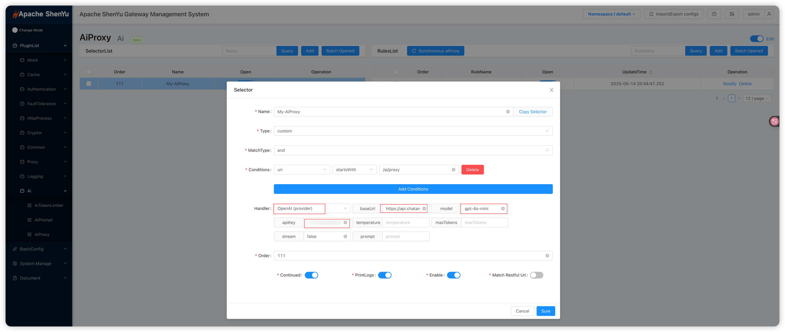
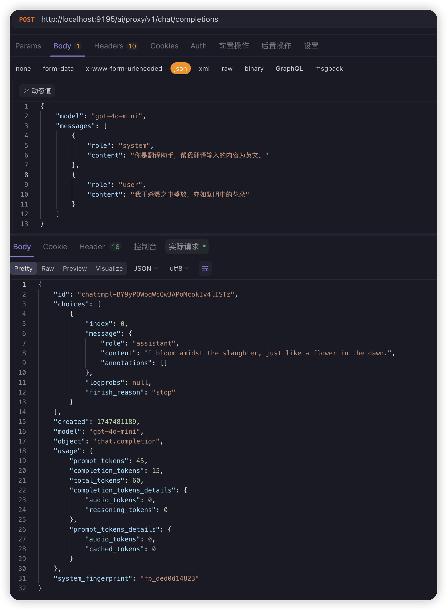

## Description

The **aiProxy** plugin acts as a forwarding proxy for LLM requests, supporting major large-model services. Users send requests through ShenYu to a route configured with aiProxy; aiProxy then uses the plugin settings—such as provider (e.g., OpenAI, Alibaba Cloud), model name, API key, etc.—to call the corresponding LLM API and return the result. Typical use cases include forwarding chat requests to OpenAI’s ChatGPT endpoint or using domestic AI services for intelligent Q&A. Similar to previous plugin usage patterns, you can think of the LLM as taking on the role of your original application service. If you have a local model compatible with the OpenAI protocol or other mainstream protocols, you can also proxy it via the shenyu-aiProxy plugin.

## Plugin Configuration

In ShenYu Admin, create a **Selector** to match requests and configure the upstream model. Then create a **Rule** under that Selector to match requests that should use those settings. For details, see [Selector and Rule Management](../../user-guide/admin-usage/selector-and-rule.md).

For the API request below, set the Selector condition to `uri startsWith /ai/proxy`. Use the following values in the Selector's **Handler** section.

| Field | Example value |
| --- | --- |
| `provider` | `OpenAI` |
| `baseUrl` | `https://api.openai.com` |
| `model` | `gpt-4o-mini` |
| `apiKey` | Your upstream OpenAI API key |



Under that Selector, enable a Rule with the same `uri startsWith /ai/proxy` condition. The Rule's Handler can be left empty. aiProxy reads the upstream settings from the matched Selector's `handle`.

> **Note:** With this setup, you also need to configure the `contextPath` plugin to remove the matched prefix and assemble the correct call URL. See [contextPath Plugin Configuration](../http-process/contextpath-plugin.md) for details.

## API Usage

After enabling the aiProxy plugin, you can send requests to the ShenYu gateway (e.g., via Postman) and obtain LLM responses through the proxy:

```bash
curl --location --request POST 'http://localhost:9195/ai/proxy/v1/chat/completions' \
  --header 'Content-Type: application/json' \
  --data-raw '{
    "model": "gpt-4o-mini",
    "messages": [
      {
        "role": "system",
        "content": "You are a translation assistant. Please translate the input content into English."
      },
      {
        "role": "user",
        "content": "I bloom amidst slaughter, like a flower at dawn."
      }
    ]
  }'
```



## API Key Management

The aiProxy plugin supports managing proxy API keys through the ShenYu Admin interface. Each proxy API key is scoped to a specific Selector and maps to a real upstream API key.

### Admin Endpoints

Base path: `/selector/{selectorId}/ai-proxy-apikey`

| Method | Path                                                    | Description                        | Permission                      |
|--------|---------------------------------------------------------|------------------------------------|---------------------------------|
| POST   | `/selector/{selectorId}/ai-proxy-apikey`                | Create a proxy API key mapping     | `system:aiProxyApiKey:add`      |
| GET    | `/selector/{selectorId}/ai-proxy-apikey`                | List proxy API key mappings (paged) | `system:aiProxyApiKey:list`     |
| PUT    | `/selector/{selectorId}/ai-proxy-apikey/{id}`           | Update a proxy API key mapping     | `system:aiProxyApiKey:edit`     |
| POST   | `/selector/{selectorId}/ai-proxy-apikey/batchDelete`    | Batch delete mappings              | `system:aiProxyApiKey:delete`   |
| POST   | `/selector/{selectorId}/ai-proxy-apikey/batchEnabled`   | Batch enable or disable mappings   | `system:aiProxyApiKey:disable`  |

### Query Parameters (GET)

| Parameter      | Required | Description                      |
|----------------|----------|----------------------------------|
| `currentPage`  | Yes      | Page number                      |
| `pageSize`     | Yes      | Page size                        |
| `proxyApiKey`  | No       | Filter by proxy API key value    |

## Proxy API Key Authentication

When `proxyEnabled` is set to `true` in the Selector configuration, the plugin enforces API key authentication on all incoming requests.

### Request Header

Clients must include the following header:

```
X-API-KEY: <proxy-api-key>
```

### Authentication Behavior

| Scenario                                         | HTTP Status       | Description                                                                                          |
|--------------------------------------------------|-------------------|------------------------------------------------------------------------------------------------------|
| `X-API-KEY` header present and valid             | 200               | Request forwarded; real upstream API key substituted transparently                                   |
| `X-API-KEY` header missing                       | 401 Unauthorized  | Request rejected                                                                                     |
| `X-API-KEY` header present but invalid           | 401 Unauthorized  | Request rejected                                                                                     |

> **Note:** When proxy mode is enabled, the real upstream API key is never exposed to the client. The plugin resolves the mapping internally and substitutes the real key before forwarding the request to the LLM provider.
