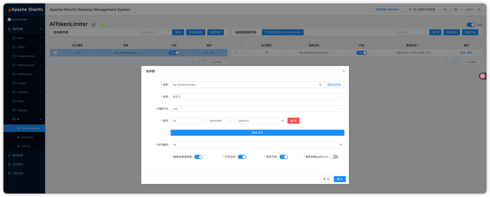
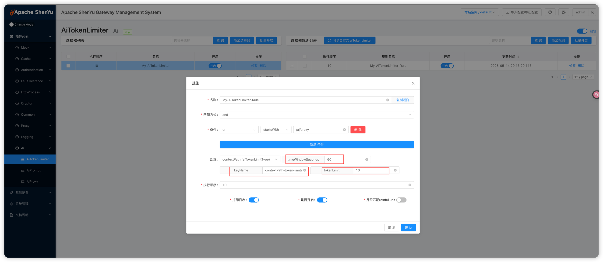
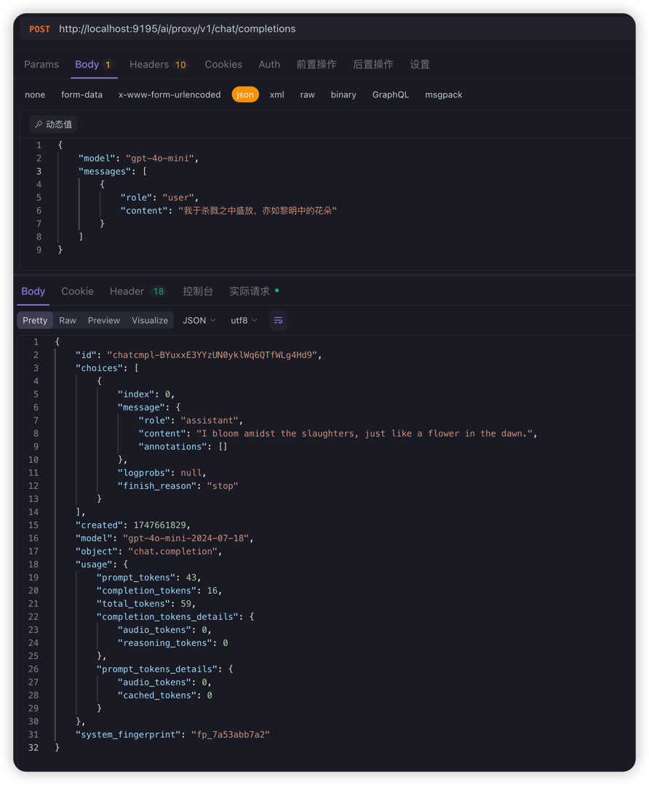
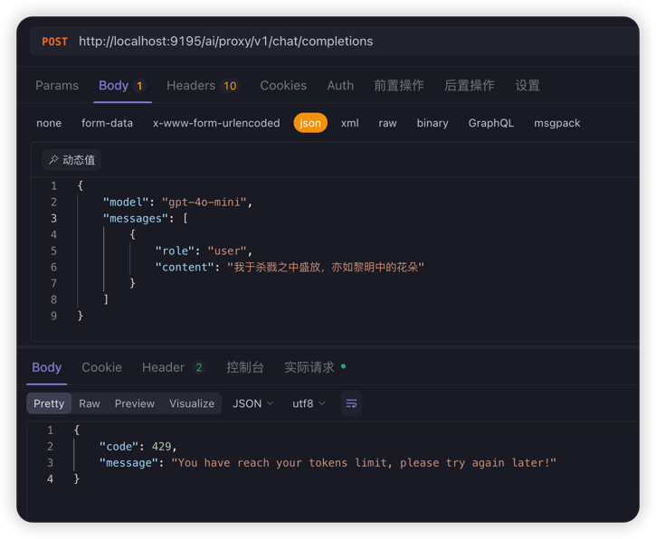

## Overview

The **aiTokenLimiter** plugin is used to track token consumption from LLM responses and enforce rate limiting via Redis. After each response, aiTokenLimiter calculates the number of tokens used and accumulates counts by user or business dimension. If the preset threshold is exceeded, subsequent requests can be rejected or throttled. Note that ShenYu’s rate limiting is typically implemented using Redis to store token buckets or sliding-window states; aiTokenLimiter likewise relies on Redis to record and check token usage. It is most commonly paired with **aiProxy** for token-based rate limiting.

## Plugin Configuration

### 2.7.2 usage accounting

The plugin counts output tokens reported in the provider protocol: `usage.completion_tokens` for Chat Completions, or `usage.output_tokens` for Responses. For Responses SSE events, it also reads `response.usage`. Fields with the same names in metadata, generated text, tool arguments, or outside the usage object are not counted. Missing or invalid usage is not inferred from the generated text. Streaming usage is parsed across event chunks; request `stream_options.include_usage` when using a provider that requires it to emit usage.

The limit is checked before forwarding a request and usage is recorded from the response. It is not a hard cutoff on an in-flight generation; concurrent requests can finish before their usage is recorded. HTTP 429 applies to subsequent requests once the recorded limit is reached.

When configuring the plugin in the ShenYu admin console, you first create a **Selector**, then a **Rule**. A **Selector** matches request conditions (e.g., path, headers), while a **Rule** defines plugin parameters or forwarding targets. For more details, see [Selector and Rule Management](../../user-guide/admin-usage/selector-and-rule).

Key fields for **aiTokenLimiter**:

- **Selector**: Defines which requests to match. For example, set `Pattern` to `/**` to match all requests, or specify a particular route.
- **Rule**: Configure plugin parameters:
    - `timeWindowSeconds`: Length of the rate-limiting window (in seconds). Within this window, the plugin tallies total token usage and compares it against `tokenLimit`.
    - `keyName`: Field name in the request used as the rate-limiting “dimension key,” in conjunction with `aiTokenLimitType` (e.g., HEADER, PARAMETER, COOKIE).
    - `tokenLimit`: Maximum number of tokens allowed within the time window. The plugin counts downstream LLM **completion tokens** (the tokens consumed by generated content). Once this limit is exceeded, further requests receive an HTTP 429 response.

Example screenshots of **aiTokenLimiter** setup in the admin interface:





> **Note:** The **aiTokenLimiter** plugin depends on **aiProxy**. In a typical flow, apply **AiPrompt** (if injecting a prompt), then **AiTokenLimiter** (for token counting/rate limiting), and finally **AiProxy** (to forward the request to the LLM). Ensure that **AiTokenLimiter**’s **sort** value is **less than** **AiProxy** and **greater than** **AiPrompt** in the “Plugin Management” list.

## API Usage

With **AiProxy** and **AiTokenLimiter** enabled, send requests through the ShenYu gateway (e.g., via Postman) to proxy LLM calls:

```bash
curl --location --request POST 'http://localhost:9195/ai/proxy/v1/chat/completions' \
--header 'Content-Type: application/json' \
--data-raw '{
    "model": "gpt-4o-mini",
    "messages": [
        {
            "role": "user",
            "content": "我于杀戮之中盛放，亦如黎明中的花朵"
        }
    ]
}'
```

Example request (before rate limiting):


With a 60-second window and `tokenLimit=10`, requests using the same dimension receive HTTP 429 after at least 10 output tokens have been reported and recorded within that window. Wait for the window to expire before retrying.

Example response (after rate limiting):

