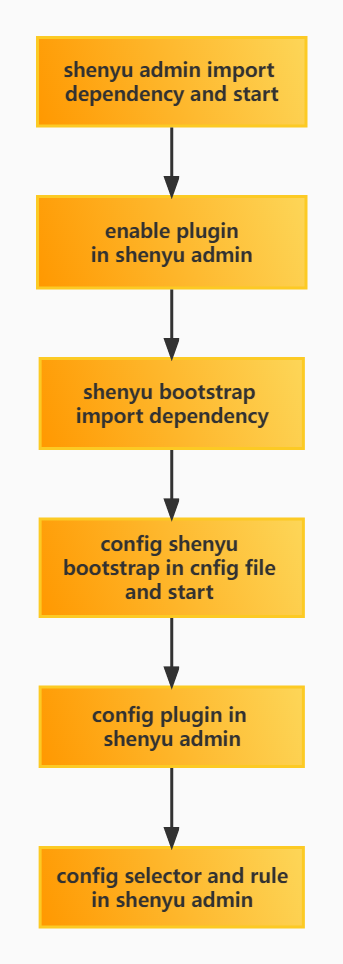
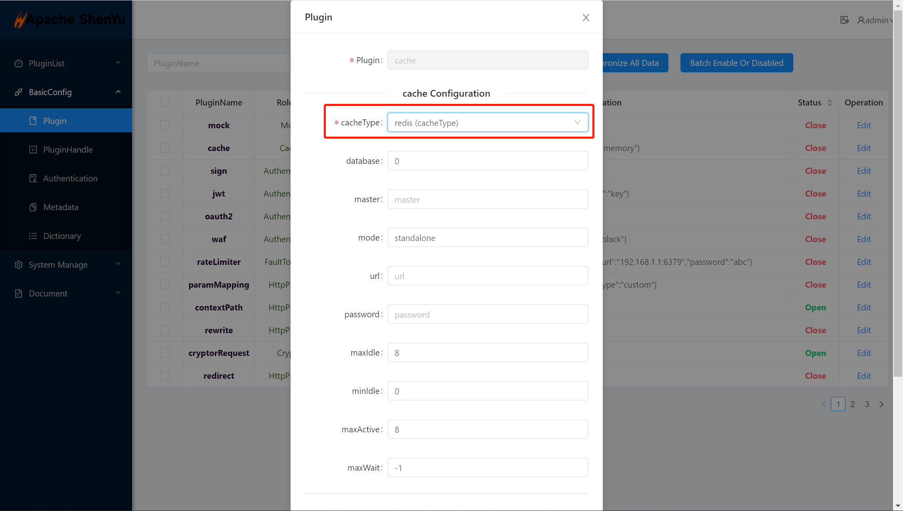

# 1. Overview

## 1.1 Plugin Name

* Cache Plugin

## 1.2 Appropriate Scenario

* Situation where data is not updated frequently and a large number of calls are required.

* For Situation where data consistency is not required.

## 1.3 Plugin functionality

* The `Cache` plugin is able to cache the results of the target service, allowing the user to configure the expiration
  time of the cached results.

## 1.4 Plugin code

* Core Module `shenyu-plugin-cache-handler`.
* Core Module `shenyu-plugin-cache-redis`.
* Core Module `shenyu-plugin-cache-memory`.

* Core Class `org.apache.shenyu.plugin.cache.CachePlugin`
* Core Class `org.apache.shenyu.plugin.cache.redis.RedisCache`
* Core Class `org.apache.shenyu.plugin.cache.memory.MemoryCache`

## 1.5 Added Since Which shenyu version

* Since 2.4.3

# 2. How to use plugin

## 2.1 Plugin-use procedure chart



## 2.2 Import pom

* Import cache plugin dependency in `ShenYu Bootstrap`.

```xml
<!--shenyu cache plugin start-->
<dependency>
  <groupId>org.apache.shenyu</groupId>
  <artifactId>shenyu-spring-boot-starter-plugin-cache</artifactId>
  <version>${project.version}</version>
</dependency>
<!--shenyu cache plugin end-->
```

## 2.3 Enable plugin

- In shenyu-admin --> BasicConfig --> Plugin --> `cache` set Status enabled.

## 2.4 Config plugin

### 2.4.1 Plugin Config



* `cacheType`: Cache currently supports two modes of caching data.

* memory:local memory mode

* redis:redis mode

The current default is `local memory mode`, the results of the target service are stored in the local memory, if the
gateway is deployed by way of cluster, it is not recommended to use `local memory mode`, it is recommended to
use `redis mode`, the data of the target service are cached in redis.

If you are using `local memory mode`, you only need to select memory in cacheType, no other configuration is needed.

If you are using `redis mode`, select redis in cacheType, and the parameters are as follows

* `database`: which database the cache results are stored in, the default is index database 0.

* `master`: default is master.

* `mode`: the working mode of redis, the default is single-point mode: `standalone`, in addition to cluster
  mode: `cluster`, sentinel mode: `sentinel`.

* `url`: configure the IP and port of the redis database, configured by colon connection, example: `192.168.1.1:6379`.

* `password`: the password of the redis database, if not, you can not configure.

* `maxldle`: the maximum free connections in the connection pool

* `minldle`: minimum idle connections in the connection pool

* `maxActive`: the maximum number of connections in the connection pool

* `maxWait`: the maximum blocking wait time for the connection pool (use negative values to indicate no limit) default -1

#### Concurrent cache misses (single-flight)

In ShenYu 2.7.2, add these optional fields to the `cache` plugin configuration JSON. They apply to both memory and Redis storage.

| Field | Default | Meaning |
| --- | --- | --- |
| `singleFlightEnabled` | `false` | Let concurrent misses for one key share a reusable response from one upstream request. |
| `singleFlightMaxKeys` | `1024` | Admission threshold for keys currently being filled on this gateway. Concurrent admissions can briefly exceed it. |
| `singleFlightMaxWaiters` | `64` | Maximum number of requests waiting for one key. |
| `singleFlightWaitTimeoutMillis` | `1000` | Maximum time, in milliseconds, that a waiting request spends on another request's fill. |
| `singleFlightFillTimeoutMillis` | `30000` | Age, in milliseconds, after which coordination may release an unfinished fill. The upstream request keeps its own timeout. |
| `singleFlightMaxResponseBytes` | `1048576` | Maximum size, in bytes, of the encoded response packet shared with waiters. It includes stored metadata and the body. |

Each gateway coordinates its own misses, including when multiple gateways share Redis. Requests can call upstream independently when capacity is exhausted, waiting times out, the fill fails or is cancelled, or the response cannot be shared. A `Vary` mismatch also causes an independent call. The sharing byte limit does not cap the response buffer, cache entry size, or gateway heap.

### 2.4.2 Selector Config

* Selectors and rules, please refer to: [Selector And Rule Config](../../user-guide/admin-usage/selector-and-rule) .

### 2.4.3 Rule Config

| Rule field | Default | Meaning |
| --- | --- | --- |
| `timeoutSeconds` | `60` | Lifetime of the stored response, in seconds. |

### 2.4.4 Request eligibility and response reuse

An eligible request must match a cache selector and rule and be a bodyless `GET`. The plugin bypasses the cache for a nonempty request body, transfer encoding, or any of these request headers:

- `Authorization`, `Cookie`, or `Range`
- `If-Match`, `If-None-Match`, `If-Modified-Since`, `If-Unmodified-Since`, or `If-Range`
- `Cache-Control` or `Pragma`

These requests continue through the gateway; the upstream handles range requests and conditional revalidation. When framing headers do not indicate a body, the plugin still checks the actual request stream and passes any body it finds to the rest of the plugin chain.

ShenYu 2.7.2 combines the request method, complete raw URI (including query), selector ID, and rule ID into a versioned key. The entry keeps the complete response status, end-to-end headers, and body together. Hop-by-hop headers, including those named by `Connection`, are excluded and the gateway sets the appropriate `Content-Length` when replaying the response. Configure the plugin for finite HTTP responses.

Responses below status 200, status 206 or 304, responses that set a cookie, and responses with `Cache-Control: private`, `no-store`, or `no-cache` are excluded. Other eligible statuses can be stored. A response with `Vary: *` is also excluded. For other `Vary` values, the entry records the corresponding request header values. A later request must carry the same values to hit that entry. There is one response per key, so a cacheable response for another variant can replace the stored response.

After upgrading from the legacy body-only cache format, the new keys start cold. Old Redis entries can expire at their original TTL without a key migration.

## 2.5 Examples

In a test gateway, configure a matching cache selector and rule for a route such as `/http/catalog`. Use an upstream that returns a cacheable response and counts requests, so its logs or counter show when the gateway calls it. Use a fresh query value for each run.

### Cache hit and bypass

```shell
url='http://localhost:9195/http/catalog?id=123'
curl -sS "$url"
curl -sS "$url"
curl -sS -H 'Authorization: Bearer example' "$url"
curl -sS -X POST -H 'Content-Type: application/json' --data-binary '{"id":123}' "$url"
```

After the first response has been stored, the second bodyless GET can hit the cache. The request with an Authorization header and the POST with a body both go to the upstream.

### Check two response variants

Have the upstream return a localized response body and `Vary: Accept-Language`. Use a fresh key.

```shell
variant_url="$url&case=vary"
curl -sS -H 'Accept-Language: en' "$variant_url"
curl -sS -H 'Accept-Language: en' "$variant_url"
curl -sS -H 'Accept-Language: fr' "$variant_url"
```

Once the English response has been stored, the second English request can hit it. The French request goes upstream because it cannot reuse the English response. If the French response is cacheable, it can replace the English entry for that key.

### Share concurrent misses

Enable `singleFlightEnabled` in the plugin configuration, make the upstream take about 500 ms, and send two requests that miss the same key on one gateway. Use a fresh key and the default wait timeout.

```shell
cold_url="$url&case=concurrent"
curl -sS -o /dev/null "$cold_url" &
curl -sS -o /dev/null "$cold_url" &
wait
```

With overlapping requests and a reusable response, the upstream counter should increase once. To see the fallback, use another fresh key and set `singleFlightWaitTimeoutMillis` to `50`. The waiting request can time out and call the upstream independently, so the counter can increase twice.

# 3. How to disable plugin

- In `shenyu-admin` --> BasicConfig --> Plugin --> `cache` set Status disable.
