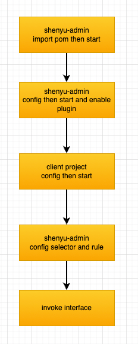
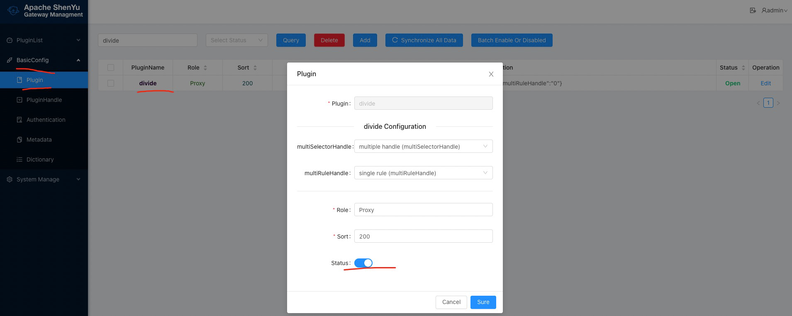
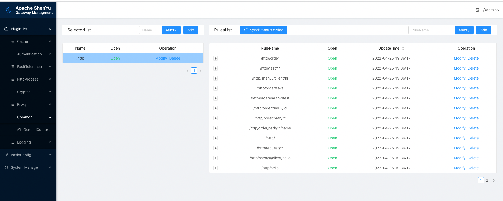
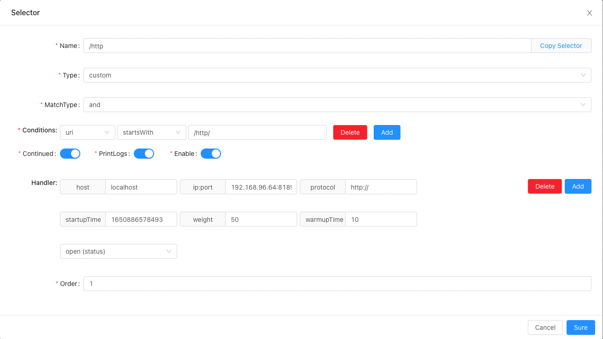
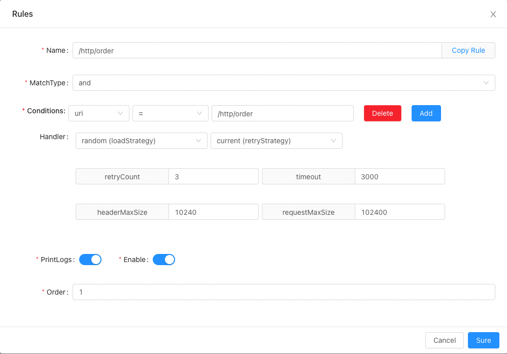
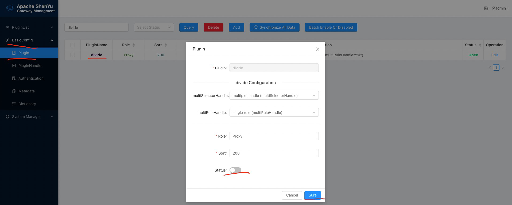

# 1. Overview

## 1.1 Plugin Name

* `divide` Plugin

## 1.2 Appropriate Scenario

* Handling `http protocol` requests.
* Support traffic management, such as a/b test, grayscale test.
* Service Load Balancing.
* Set request timeout.

## 1.3 Plugin functionality

* Supports traffic management based on request information such as uri, header, and query.
* Supports setting the load balancing strategy for requests, and supports service warm-up. Currently, three strategies are supported: ip hash (consistent hash with virtual nodes), round-robbin (weighted polling), random (weighted random).
* Supports setting the maximum value of the request header, the maximum value of the request body, and the request level timeout.
* Supports setting the timeout retry policy and the number of retries. Currently, the retry policy supports: current (retrying the server that failed before) and failover (retrying other servers).

## 1.4 Plugin Code

* Core module is ```shenyu-plugin-divide```.
* Core class is ```org.apache.shenyu.plugin.divide.DividePlugin```.

# 2. How to use plugin

## 2.1 Plugin-use procedure chart



## 2.2 Import pom

- Import maven in shenyu-bootstrap project's `pom.xml` file.

```xml
  <dependency>
      <groupId>org.apache.shenyu</groupId>
      <artifactId>shenyu-spring-boot-starter-gateway</artifactId>
     <version>${project.version}</version>
  </dependency>
```

## 2.3 Enable plugin

- In `shenyu-admin` --> BasicConfig --> Plugin --> `divide` set Status enable.



## 2.4 Config plugin

### 2.4.1 Configure access parameters in the client project configuration file

* Client access method and server address. The following example uses the http access method. Currently, the client supports the following access methods: http, zookeeper, etcd, nacos, consul. For detailed access configuration parameters, please refer to [Client Access Configuration](../../user-guide/property-config/register-center-access.md).
* Client configuration, including the protocol name and the routing address of the service, please use the http protocol here, and the value of contextPath must be configured as the routing address of each service.

```yaml
  shenyu:
    register:
      registerType: http
      serverLists: http://localhost:9095
      props:
        username: admin
        password: 123456
    client:
      http: # http protocol
        props:
          contextPath: /http # routing address for each service
```      

### 2.4.2 Configure upstream validity detection parameters in the shenyu-admin configuration file

The following example uses the http access method. Currently, the client supports the following access methods: http, zookeeper, etcd, nacos, consul. For detailed access configuration parameters, please refer to [Client Access Configuration](../../user-guide/property-config/register-center-access.md).
> Only http-type registries support upstream detection.

```yaml
  shenyu:
    register:
      registerType: http # Only http-type register center support upstream detection.
      serverLists: 
      props:
        checked: true # The default is true, set to false, do not detect.
        zombieCheckTimes: 5 # The maximum number of zombie upstream detections. If it exceeds 5 times, its validity will no longer be detected. The default value is 5.
        scheduledTime: 10 # Timing detection interval, the default is 10 seconds.
        zombieRemovalTimes: 60 # How many seconds the upstream is offline to be considered as a zombie upstream, the default is 60 seconds.
```

### 2.4.3 Configure the selector and rule information of the divide plugin in shenyu-admin

After the client is started, the [selector and rule](../../user-guide/admin-usage/selector-and-rule) information will be automatically registered in shenyu-admin -> Plugin List -> Proxy -> Divide.



#### 2.4.3.1 Selector configuration

Example of divide selector. For general selector configuration, please refer to [Selectors and Rules](../../user-guide/admin-usage/selector-and-rule).



##### 2.4.3.1.1 Selector handling information configuration

- `host`: fill in `localhost`, this field is not used currently.
- `ip:port`: `ip` and port, fill in the `ip` + port of your real service here.
- `protocol`: `http` protocol, fill in `http:` or `https:`, if not fill in, the default is: `http:`.
- `startupTime`: Startup time in milliseconds.
- `weight`: load balancing weight, the default value of service startup automatic registration is 50.
- `warmupTime`: Warmup time, in milliseconds. The server during warmup will calculate the instantaneous weight, and the calculated value will be smaller than the actual configured weight to protect the server just started. The default value of service startup registration is 10. For example, the warm-up time is 100 milliseconds, the current startup is 50 milliseconds, the configured weight is 50, and the actual weight is 25.
- `status`: On or off, this selector is valid only in the on state.

#### 2.4.3.2 Processing information configuration of rules

Example of divide rule. For general rule configuration, please refer to [selectors and rules](../../user-guide/admin-usage/selector-and-rule).



##### 2.4.3.2.1 Rule processing information configuration

- `loadStrategy`: If the `http` client is a cluster, which load balancing strategy is used when the `Apache ShenYu` gateway is called, currently supports `roundRobin`, `random` and `hash`.
- `timeout`: The timeout of a single call attempt to the `http` client, in milliseconds, the default value is 3000. An attempt covers waiting for the response and reading it, so a slower-than-timeout response is cut by this deadline rather than by the transport-level read deadlines.
- `retry Count`: The number of retries after a failed call, the default value is 3. Timeouts (connection establishment, reads, the attempt) and connection-level transport errors are retried; data-buffer limit errors are not.
- `headerMaxSize`: The maximum value of the requested `header`.
- `requestMaxSize`: The maximum value of the request body.
- `retryStrategy`: Supported since `2.4.3`, retry strategy after failure, default `current` to maintain compatibility with lower versions. For example, there are 3 downstream services `http:localhost:1111`, `http:localhost:1112` and `http:localhost:1113`, assuming the first load balancing to `http:localhost:1111` and `call failed`. Using the `current` strategy will continue to retry calling `http:localhost:1111`; using the `failover` strategy will retry calling other services such as `http:localhost:1112` through the `load balancing`, if it fails again at this time , call to `http:localhost:1113` until no service is available.
- `retryBackOffSpec`: The back-off used between retries, the default is `default`. `default` uses a capped random back-off (20 ms minimum, 20 s cap, 0.5 jitter); `fixed` uses a flat 2 s delay; `exponential` uses an exponential back-off starting at 500 ms with a 5 s cap.
- `requestTimeout`: Optional. When set, it bounds the whole retry sequence - every attempt, the back-off in between and writing the response - and an expired deadline returns `HTTP 504`. When it is not set, the sequence is additionally guarded by an implicit aggregate budget `(retry + 1) * timeout + retry * maximumBackoff`, where `maximumBackoff` is the cap of the chosen `retryBackOffSpec` (20 s for `default`, 2 s for `fixed`, 5 s for `exponential`); exceeding this budget also fails the sequence.
- `poolGroup`: Optional. Selects a named connection pool defined in `shenyu.httpclient.pool-groups` (see the gateway property config page). An unknown group name returns `HTTP 503` instead of falling back to the shared default pool.

Exhausting the attempts and exhausting the aggregate budget produce different statuses: when the allowed number of attempts is exhausted, the client returns `HTTP 408` ("the maximum number of retry times has been exceeded"); when the whole-sequence budget or `requestTimeout` expires first, the client returns `HTTP 504`. Budgeted retries count both the per-attempt deadline and the aggregate bound instead of multiplying a single timeout informally.

Worked example for an ordinary request versus a slow stream, and which control terminates it:

* An ordinary fast request under the defaults is bounded per attempt by `timeout` (3000 ms). If each attempt hangs, the attempt times out, the configured number of retries runs, and the sequence ends with `HTTP 408` when the count is exhausted - or with `HTTP 504` if the aggregate budget runs out first.
* A slow streaming response (SSE, long polling) that stays active is still terminated after `timeout` milliseconds of total attempt time, even when nothing stalled. To proxy such endpoints, raise the rule's `timeout` (and consider `requestTimeout` for the whole sequence). Disabling `shenyu.httpclient.responseTimeout` alone does not help: `responseTimeout` bounds the gaps between response reads including body reads, and after it is disabled the transport-level read deadlines (`shenyu.httpclient.readTimeout` and the idle thresholds) and the rule-side deadlines still terminate a stalled or over-long stream.

## 2.5 Examples

### 2.5.1 Example A/B Test

To be added, welcome contribute.

### 2.5.2 Example Grayscale Test

To be added, welcome contribute.

# 3. How to disable plugin

- In `shenyu-admin` --> BasicConfig --> Plugin --> `divide` set Status disable.


