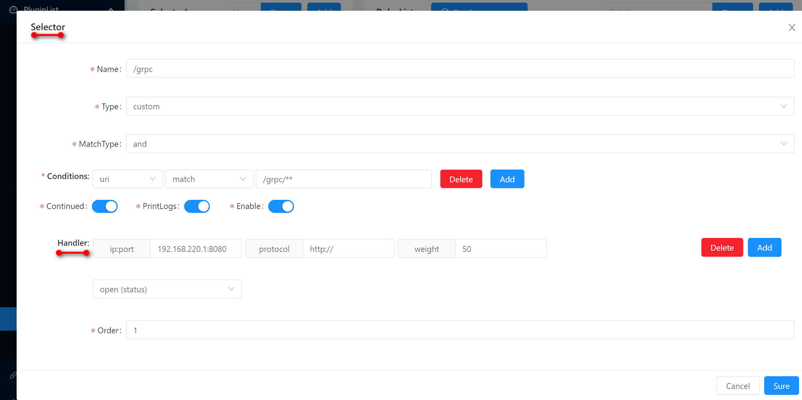
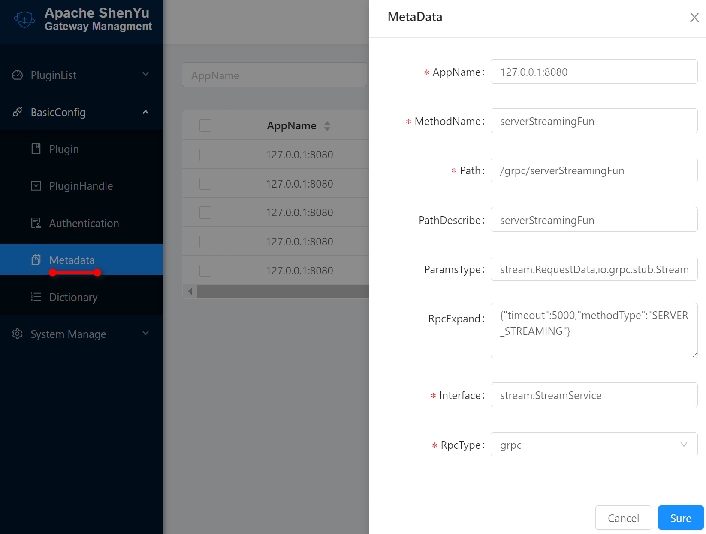

## Description

The `grpc` plugin bridges HTTP/JSON requests to a ShenYu JSON service adapter on a gRPC backend. Use the ShenYu gRPC client starter and `@ShenyuGrpcClient` to expose the adapter and register method metadata. The gateway calls the adapter's JSON service descriptor, for example `stream.StreamServiceJSON/unaryFun`.

### HTTP bridge behavior {#http-bridge-behavior}

| Backend method type | HTTP request body | Successful HTTP response |
| --- | --- | --- |
| Unary | One message in the `data` array | A JSON array with one result |
| Server streaming | One message in the `data` array | A single JSON array with the collected results |
| Client streaming | Multiple messages in the `data` array | A JSON array with the backend's one result |
| Bidirectional streaming | Multiple messages in the `data` array | A single JSON array with the collected results |

The gateway reads the entire HTTP body before sending input messages to the backend. It waits for the gRPC call to finish before sending a successful HTTP response, even if the backend emits results earlier. Use finite streams and plan the gRPC deadline to cover the whole call. The first HTTP result is delayed until completion, and the gateway retains the result payloads in memory while the call runs.

The HTTP bridge does not support live bidirectional interaction, infinite subscriptions, SSE, NDJSON, gRPC-Web, or direct native gRPC calls from tools such as `grpcurl`. A separate [native gRPC proxy](https://github.com/apache/shenyu/issues/8184) is proposed. The HTTP bridge still uses the `grpc` plugin identifier.

### Aggregate response limits {#aggregate-response-limits}

In ShenYu 2.7.2, edit the **grpc plugin configuration** in Admin and add the following fields to its JSON configuration. These limits apply per call. Omitted, null, zero, and negative values leave the corresponding dimension unlimited.

```json
{
  "maxAggregatedResultCount": 100,
  "maxAggregatedResultBytes": 1048576
}
```

- `maxAggregatedResultCount` counts retained response items.
- `maxAggregatedResultBytes` counts retained JSON payload bytes in UTF-8. It does not measure gRPC wire bytes, the final HTTP body size, or gateway heap usage.

Exceeding either limit discards the collected results and cancels the gRPC call. The HTTP request fails without returning a partial success array. The [quick start](../../quick-start/quick-start-grpc.md#finite-streaming-examples) shows a finite response and how to trigger the count limit.


## Plugin Setting

* Add related dependencies and enable plugin, please refer to: [Quick start with gRPC](../../quick-start/quick-start-grpc) .

* `gRPC` client access, please refer to: [gRPC Proxy](../../user-guide/proxy/grpc-proxy.md) .

* New fields and meanings of grpc plugin since `2.4.3`:

  * `threadpool`:There are two types of business thread pools, `cached` and `shared`.

    `cached` is equivalent to the default thread pool officially provided by grpc;

    `shared` thread pool, just as its name, `all proxy plugins` share a `shared` `Thread pool, the advantage of doing this is that it can reduce the number of thread pools, thereby reducing memory and improving resource utilization.


## Plugin Detail


After the client accesses the `Apache ShenYu` gateway, it will automatically register the selector and rule information. You can see it in PluginList -> rpc proxy -> grpc. For details about the selector and rule configuration, see [Selector And Rule Config](../../user-guide/admin-usage/selector-and-rule) .


#### Selector Handler




Selector Handler, the `handle` field, is the processing operation that the gateway can perform after matching the traffic.


* config details:

  * `ip:port`:enter the ip:port of your real service .

  * `protocol`:indicates the Http protocol. Generally, the value is `http://` or `https://`. If the value is not specified, the default value is `http://` .

  * `weight`:service weight.

  * `status`:open or close.


## Metadata

Each `grpc` interface method, will correspond to a metadata, when the `grpc` application client access to the `Apache ShenYu` gateway, will be automatically registered, can be viewed in the `shenyu-admin` background management system of the BasicConfig --> Metadata management.




* AppName: specifies the name of the application to which the metadata belongs.

* MethodName: the name of the method to call.

* Path: http request path.

* PathDescribe: the description of the path is easy to view.

* ParamsType: the parameters are separated by commas (,) in the order of interface parameter types.

* RpcExpand: other configurations of the `grpc` interface, which support the `JSON` format, are as follows:

```json
{
  "timeout": 5000,
  "methodType": "SERVER_STREAMING"
}
```

* Interface: The fully qualified class name of the `grpc` interface.

* RpcType:choose `grpc`.
