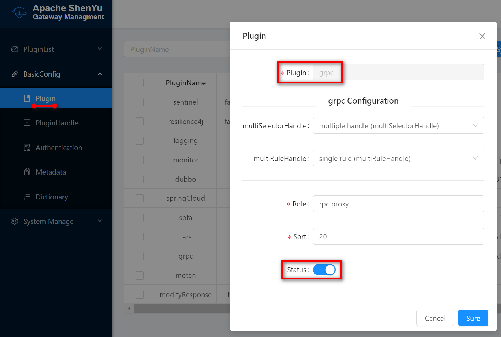
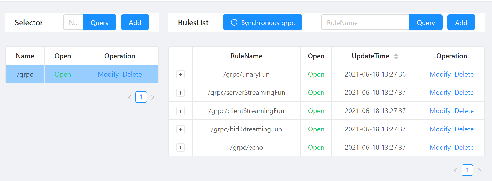
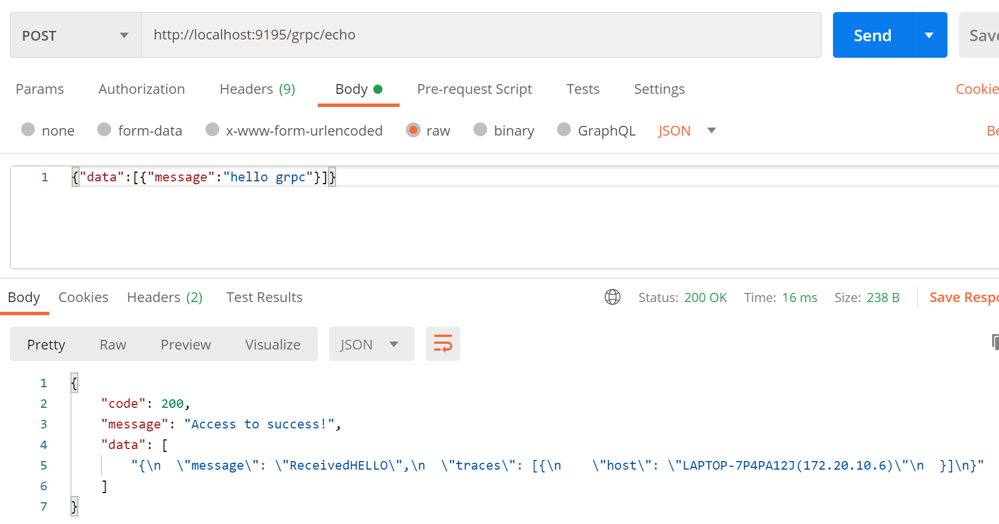

This document introduces how to quickly access the Apache ShenYu gateway using gRPC. You can get the code example of this document by clicking [here](https://github.com/apache/shenyu/tree/v2.7.2/shenyu-examples/shenyu-examples-grpc) .

## Prepare For Environment

Please refer to the deployment to select a way to start shenyu-admin. For example, start the Apache ShenYu gateway management system through [local deployment](../deployment/deployment-local) .

After successful startup, you need to open the gRPC plugin on in the BasicConfig `->` Plugin.



If you are a startup gateway by means of source, can be directly run the ShenyuBootstrapApplication of shenyu-bootstrap module.

> Note: Before starting, make sure the gateway has added dependencies.


Add the following dependencies to the gateway's `pom.xml` file:

```xml
        <!-- apache shenyu grpc plugin start-->
        <dependency>
            <groupId>org.apache.shenyu</groupId>
            <artifactId>shenyu-spring-boot-starter-plugin-grpc</artifactId>
            <version>${project.version}</version>
        </dependency>
        <!-- apache shenyu grpc plugin end-->
```

## Run the shenyu-examples-grpc project

Download [shenyu-examples-grpc](https://github.com/apache/shenyu/tree/v2.7.2/shenyu-examples/shenyu-examples-grpc)

Run the following command under `shenyu-examples-grpc` to generate Java code:

```shell
mvn protobuf:compile 
mvn protobuf:compile-custom 
```

Execute the `org.apache.shenyu.examples.grpc.ShenyuTestGrpcApplication` main method to start project.

The following log appears when the startup is successful:

```shell
2021-06-18 19:33:32.866  INFO 11004 --- [or_consumer_-19] o.a.s.r.client.http.utils.RegisterUtils  : grpc client register success: {"appName":"127.0.0.1:8080","contextPath":"/grpc","path":"/grpc/clientStreamingFun","pathDesc":"clientStreamingFun","rpcType":"grpc","serviceName":"stream.StreamService","methodName":"clientStreamingFun","ruleName":"/grpc/clientStreamingFun","parameterTypes":"io.grpc.stub.StreamObserver","rpcExt":"{\"timeout\":5000,\"methodType\":\"CLIENT_STREAMING\"}","enabled":true,"host":"172.20.10.6","port":8080,"registerMetaData":false} 
2021-06-18 19:33:32.866  INFO 11004 --- [or_consumer_-17] o.a.s.r.client.http.utils.RegisterUtils  : grpc client register success: {"appName":"127.0.0.1:8080","contextPath":"/grpc","path":"/grpc/echo","pathDesc":"echo","rpcType":"grpc","serviceName":"echo.EchoService","methodName":"echo","ruleName":"/grpc/echo","parameterTypes":"echo.EchoRequest,io.grpc.stub.StreamObserver","rpcExt":"{\"timeout\":5000,\"methodType\":\"UNARY\"}","enabled":true,"host":"172.20.10.6","port":8080,"registerMetaData":false} 
2021-06-18 19:33:32.866  INFO 11004 --- [or_consumer_-20] o.a.s.r.client.http.utils.RegisterUtils  : grpc client register success: {"appName":"127.0.0.1:8080","contextPath":"/grpc","path":"/grpc/bidiStreamingFun","pathDesc":"bidiStreamingFun","rpcType":"grpc","serviceName":"stream.StreamService","methodName":"bidiStreamingFun","ruleName":"/grpc/bidiStreamingFun","parameterTypes":"io.grpc.stub.StreamObserver","rpcExt":"{\"timeout\":5000,\"methodType\":\"BIDI_STREAMING\"}","enabled":true,"host":"172.20.10.6","port":8080,"registerMetaData":false} 
2021-06-18 19:33:32.866  INFO 11004 --- [or_consumer_-21] o.a.s.r.client.http.utils.RegisterUtils  : grpc client register success: {"appName":"127.0.0.1:8080","contextPath":"/grpc","path":"/grpc/unaryFun","pathDesc":"unaryFun","rpcType":"grpc","serviceName":"stream.StreamService","methodName":"unaryFun","ruleName":"/grpc/unaryFun","parameterTypes":"stream.RequestData,io.grpc.stub.StreamObserver","rpcExt":"{\"timeout\":5000,\"methodType\":\"UNARY\"}","enabled":true,"host":"172.20.10.6","port":8080,"registerMetaData":false} 
2021-06-18 19:33:32.866  INFO 11004 --- [or_consumer_-18] o.a.s.r.client.http.utils.RegisterUtils  : grpc client register success: {"appName":"127.0.0.1:8080","contextPath":"/grpc","path":"/grpc/serverStreamingFun","pathDesc":"serverStreamingFun","rpcType":"grpc","serviceName":"stream.StreamService","methodName":"serverStreamingFun","ruleName":"/grpc/serverStreamingFun","parameterTypes":"stream.RequestData,io.grpc.stub.StreamObserver","rpcExt":"{\"timeout\":5000,\"methodType\":\"SERVER_STREAMING\"}","enabled":true,"host":"172.20.10.6","port":8080,"registerMetaData":false} 
```


## Test

The `shenyu-examples-grpc` project will automatically register interface methods annotated with `@ShenyuGrpcClient` in the Apache ShenYu gateway after successful startup.

Open PluginList -> rpc proxy -> gRPC to see the list of plugin rule configurations:



Use `postman` to simulate `http` to request your gRPC service. The following is the request body.

```json
{
    "data": [
        {
            "message": "hello grpc"
        }
    ]
}
```



The parameters are passed in json format. The name of the key is `data` by default, and you can reset it in `GrpcConstants.JSON_DESCRIPTOR_PROTO_FIELD_NAME`. The input of value is based on the proto file defined by you.

## Finite streaming examples {#finite-streaming-examples}

Once the sample app has registered its ShenYu JSON service adapter, send HTTP/JSON requests to the gateway. The gateway reads all messages from the `data` array before sending them to the backend. Each successful request returns one JSON array after the gRPC call completes.

```shell
gateway=http://localhost:9195
one='{"data":[{"text":"hello"}]}'
two='{"data":[{"text":"hello"},{"text":"again"}]}'

curl -sS -H 'Content-Type: application/json' -d "$one" "$gateway/grpc/unaryFun"
curl -sS -H 'Content-Type: application/json' -d "$two" "$gateway/grpc/clientStreamingFun"
curl -sS -H 'Content-Type: application/json' -d "$one" "$gateway/grpc/serverStreamingFun"
curl -sS -H 'Content-Type: application/json' -d "$two" "$gateway/grpc/bidiStreamingFun"
```

The sample returns one `{"text":"unaryFun response: hello gRPC"}` result for unary and one completion result for client streaming. Server streaming returns ten results in one array. Bidirectional streaming returns three results for these two input messages: one per input and a final completion result.

To observe the count limit, first confirm that the server-streaming request returns ten items. In Admin, set `"maxAggregatedResultCount": 5` in the `grpc` plugin's JSON configuration. After configuration sync, repeat the request. It should fail instead of returning the first five items. Restore the previous setting after the experiment. See [aggregate response limits](../plugin-center/proxy/grpc-plugin.md#aggregate-response-limits) for the byte limit and defaults.
