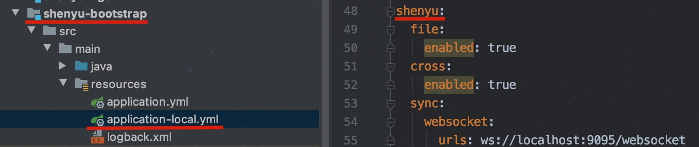

This paper mainly explains how to configure `Apache ShenYu` properties on the gateway side.



### Property Config

```yaml
shenyu:
  # match-cache settings below reflect the current development line; ShenYu 2.7.1 and earlier used the removed trie L2 caches
  selectorMatchCache:
    ## bounded per-path match cache for selectors
    cache:
      enabled: true
      initialCapacity: 10000 # initial capacity in cache
      maximumSize: 10000 # max size in cache
      ttl: 60000 # match result lifetime in milliseconds, must be positive
  ruleMatchCache:
    ## bounded per-path match cache for rules
    cache:
      enabled: true
      initialCapacity: 10000 # initial capacity in cache
      maximumSize: 10000 # max size in cache
      ttl: 60000 # match result lifetime in milliseconds, must be positive
  netty:
    http:
      webServerFactoryEnabled: true
      selectCount: 1
      workerCount: 4
      accessLog: false
      serverSocketChannel:
        soRcvBuf: 87380
        soBackLog: 128
        soReuseAddr: true
        connectTimeoutMillis: 30000
        writeBufferHighWaterMark: 65536
        writeBufferLowWaterMark: 32768
        writeSpinCount: 16
        autoRead: false
        allocType: "pooled"
        messageSizeEstimator: 8
        singleEventExecutorPerGroup: true
      socketChannel:
        soKeepAlive: false
        soReuseAddr: true
        soLinger: -1
        tcpNoDelay: true
        soRcvBuf: 87380
        soSndBuf: 16384
        ipTos: 0
        allowHalfClosure: false
        connectTimeoutMillis: 30000
        writeBufferHighWaterMark: 65536
        writeBufferLowWaterMark: 32768
        writeSpinCount: 16
        autoRead: false
        allocType: "pooled"
        messageSizeEstimator: 8
        singleEventExecutorPerGroup: true
  instance:
    enabled: false
    registerType: zookeeper #etcd #consul
    serverLists: localhost:2181 #http://localhost:2379 #localhost:8848
    props:
#  httpclient:
#    strategy: netty # supports webClient or netty, the default value is netty
#    connectTimeout: 45000 # TCP connection establishment timeout, in milliseconds
#    responseTimeout: 3000 # wait applied to each proxied response, in milliseconds; 0 or a negative value disables the wait
#    readerIdleTime: 3000 # idle-state thresholds of the per-connection idle handler, in milliseconds
#    writerIdleTime: 3000
#    allIdleTime: 3000
#    readTimeout: 3000 # per-read deadline in milliseconds, a non-positive value disables the read deadline handler
#    writeTimeout: 3000 # per-write deadline in milliseconds
#    wiretap: false
#    keepAlive: true # reuse upstream connections; false is an escape hatch for stale-connection resets (reactor-netty#388)
#    pool:
#      type: FIXED # supports FIXED (default), ELASTIC (legacy name, same finite limits) or DISABLED
#      name: shenyu-proxy # the default pool name; opt-in per-rule pools are configured separately through shenyu.httpclient.pool-groups
#      maxConnections: 16 # example tuning value; must be positive, the default follows Reactor Netty
#      acquireTimeout: 3000 # maximum time in milliseconds waiting for a pooled connection; 0 disables the wait, negative values are rejected
#      maxPendingAcquires: 32 # omitted means 2*maxConnections; -1 removes the queue bound; 0 and values below -1 are rejected
#      maxIdleTime: # omitted means no idle eviction; keep below the upstream/load-balancer idle timeout for FIXED pools
#      maxLifeTime:
#      evictionInterval:
#      metrics: false # requires micrometer-core on the classpath
#    proxy:
#      host:
#      port:
#      username:
#      password:
#      nonProxyHostsPattern:
#    ssl:
#      useInsecureTrustManager: true
#      keyStoreType: PKCS12
#      keyStorePath: classpath:keystore.p12
#      keyStorePassword: 123456
#      keyStoreProvider: 
#      keyPassword: 123456
#      trustedX509Certificates:
#      handshakeTimeout:
#      closeNotifyFlushTimeout:
#      closeNotifyReadTimeout:
#      defaultConfigurationType:
  sync:
    websocket:
      urls: ws://localhost:9095/websocket
      allowOrigin: ws://localhost:9195
#    zookeeper:
#      url: localhost:2181
#      sessionTimeout: 5000
#      connectionTimeout: 2000
#    http:
#      url: http://localhost:9095
#    nacos:
#      url: localhost:8848
#      namespace: 1c10d748-af86-43b9-8265-75f487d20c6c
#      username:
#      password:
#      acm:
#        enabled: false
#        endpoint: acm.aliyun.com
#        namespace:
#        accessKey:
#        secretKey:
#    etcd:
#      url: http://localhost:2379
#    consul:
#      url: http://localhost:8500
#      waitTime: 1000
#      watchDelay: 1000
  cross:
    enabled: true
    allowedHeaders:
    allowedMethods: "*"
    allowedAnyOrigin: false
    allowedOrigin:
      # format : schema://prefix spacer domain
      # Access-Control-Allow-Origin: "http://a.apache.org,http://b.apache.org"
      spacer: "."
      domain: apache.org
      prefixes:
        - a # a.apache.org
        - b # b.apache.org
      origins:
        - c.apache.org
        - d.apache.org
        - http://e.apache.org
      originRegex: ^http(|s)://(.*\.|)abc.com$
    allowedExpose: ""
    maxAge: "18000"
    allowCredentials: true
  switchConfig:
    local: true
  file:
    enabled: true
    maxSize : 10
  exclude:
    enabled: false
    paths:
      - /favicon.ico
  fallback:
    enabled: false
    paths:
      - /fallback/hystrix
      - /fallback/resilience4j
  health:
    enabled: false
    paths:
      - /actuator/health
      - /health_check
  alert:
    enabled: true
    admins: localhost:9095
  extPlugin:
    path:
    enabled: true
    threads: 1
    scheduleTime: 300
    scheduleDelay: 30
  scheduler:
    enabled: false
    type: fixed
    threads: 16
  upstreamCheck:
    enabled: false
    timeout: 3000
    healthyThreshold: 1
    unhealthyThreshold: 1
    interval: 5000
    printEnabled: true
    printInterval: 60000
  ribbon:
    serverListRefreshInterval: 10000
  metrics:
    enabled: false
    name : prometheus
    host: 127.0.0.1
    port: 8090
    jmxConfig:
    props:
      jvm_enabled: true
  sharedPool:
    enable: true
    prefix: "shenyu-shared"
    corePoolSize: 200
    maximumPoolSize: 2000
    keepAliveTime: 60000
    maxWorkQueueMemory: 1073741824 # 1GB
    maxFreeMemory: 268435456 # 256MB
```

### Property Detail


##### shenyu.selectorMatchCache.cache & shenyu.ruleMatchCache.cache config

`shenyu.selectorMatchCache.cache` and `shenyu.ruleMatchCache.cache` bind to `MatchCacheConfig`, a bounded per-path match cache for selector and rule matching. There is no separate `shenyu.matchCache` prefix, and no trie/L2 cache in the current implementation.

This section documents the current development line (verified against `2.7.3-SNAPSHOT`). ShenYu 2.7.1 and earlier shipped the former trie-based L2 caching instead; see the [2.7.1 versioned page](/docs/2.7.1/user-guide/property-config/gateway-property-config) for the settings that release actually supported.

The following values are the Java-model defaults; a concrete distribution sample may override them.

| Field           | Type    | Default | Required | Description                                                                                                    |
|-----------------|---------|---------|----------|-----------------------------------------------------------------------------------------------------------------|
| enabled         | Boolean | true    | No       | Whether to consult the bounded per-path match cache when matching selectors or rules. Entries are still only written when the candidate set is path-safe (see below). |
| initialCapacity | int     | 10000   | No       | Initial capacity of the match cache.                                                                            |
| maximumSize     | long    | 10000   | No       | Maximum number of cached path entries.                                                                         |
| ttl             | long    | 60000   | No       | Match result lifetime in **milliseconds**. Must be positive; a non-positive value is rejected with `Match cache ttl must be positive` during property binding. |

###### What gets cached

Entries are keyed by `(pluginName, path)` and hold the winning selector/rule, or a negative entry meaning "no candidate matched this path". Because a cache hit skips the entire current candidate set, an entry is written only when matching is decided by the request path alone:

* Every enabled candidate selector/rule is decided by URI conditions using one of the path-only operators: `=`, `equals`, `contains`, `startsWith`, `endsWith`, `match`, `regex`, `exclude`, `pathPattern`, `isBlank`.
* No enabled candidate is marked `matchRestful`, and no candidate has an empty condition list (for example a full-match selector) — such candidates always match live and never produce a cache entry.
* Positive entries require exactly one distinct matching candidate. When two or more distinct candidates match the same request, a winner is still chosen by condition specificity and sort order, but the result is not cached.
* A rule-level negative entry is keyed without a selector id, so it is only sound when the whole selector set of that plugin is also decided by path only.

Conditions on headers, query parameters, cookies, IP/host, time-dependent predicates or custom SPI operators depend on state beyond the URI and are not eligible: matching simply runs on every request. This is a safety restriction of the implementation, not advice about URI-looking rules in general.

Example: a selector whose conditions are only a `uri` condition such as `pathPattern /api/**` is cacheable — its outcome depends solely on the request path. A selector that additionally conditions on a header (`X-Token: abc`) is not, because two requests for the same path with different header values may match differently. Note that eligibility is decided by the whole candidate set, not by the winning rule alone: a path-keyed entry would skip every candidate on a cache hit, so caching only happens when no enabled candidate depends on non-path state.

###### Expiry and configuration changes

Entries live at most `ttl` milliseconds (default 60s) and are recomputed from the current selector/rule data on the next matching request after expiry. Configuration changes are not pushed into a running gateway's match cache instantly: each gateway node serves from its own cache until entries expire, so treat `ttl` as the bound on stale match results. There is no cross-gateway synchronization of these entries.

###### Upgrade note for releases before the removal

ShenYu 2.7.1 and earlier shipped a trie L2 cache configured through `shenyu.selectorMatchCache.trie.*` and `shenyu.ruleMatchCache.trie.*` (`enabled`, `cacheSize`, `matchMode`). Those configuration sections and the trie engine no longer exist in the current implementation: the leftover keys are ignored by default property binding and do not restore trie matching. Remove them and use `shenyu.selectorMatchCache.cache` / `shenyu.ruleMatchCache.cache` above.

##### shenyu.NettyTcpProperties config

The apache shenyu reactor-netty config.

| Name                          | Type    | Default | Required | Description                                                                                                                               |
|:------------------------------|:--------|:-------:|:--------:|:------------------------------------------------------------------------------------------------------------------------------------------|
| webServerFactoryEnabled       | Boolean |  true   |    No    | Whether to enable custom parameters. True-enable. False-NettyReactiveWebServerFactory Can be configured by yourself.                      |
| selectCount                   | Integer |    1    |    No    | Number of netty selectors.                                                                                                                |
| workerCount                   | Integer |    4    |    No    | Number of netty workers.                                                                                                                  |
| accessLog                     | Boolean |  false  |    No    | netty request parameters.                                                                                                                 |
| **ServerSocketChannelConfig** |         |         |          |                                                                                                                                           |
| soRcvBuf                      | Integer |  --  |    No    | Socket config, the size of the socket receive buffer. The default value is system dependent. |
| soBackLog                     | Integer |   128   |    No    | Socket config, maximum length of the accept queue.                                                                                        |
| soReuseAddr                   | Boolean |  true  |    No    | Socket config, allow reuse of local addresses. The default value in reactor-netty is true. |  
| connectTimeoutMillis          | Integer | 30000     | No       | Netty config, the connect timeout of the channel in milliseconds. |
| writeBufferHighWaterMark      | Integer |  65536  |    No    | Netty config, the high water mark of the write buffer.                                                                                    |
| writeBufferLowWaterMark       | Integer |  32768  |    No    | Netty config, the low water mark of the write buffer.                                                                                     |
| writeSpinCount                | Integer |   16    |    No    | Netty config, the maximum loop count for a write operation.                                                                               |
| autoRead                      | Boolean | false     | No       | Netty config, channel read method will be invoked automatically so that a user application doesn't need to call it at all. The default value in reactor-netty is false, and can only be false. |
| allocType                     | String  | pooled  |    No    | Netty config, set the ByteBufAllocator which is used for the channel to allocate buffers.                                                 |
| messageSizeEstimator          | Integer |    8    |    No    | Netty config, message size estimator, estimate ByteBuf,ByteBufHolder and FileRegion size.                                                 |
| singleEventExecutorPerGroup   | Boolean |  true   |    No    | Netty config, single thread execute the event of ChannelPipeline.                                                                         |
| **SocketChannelConfig**       |         |         |          |                                                                                                                                           |
| soKeepAlive                   | Boolean |  false  |    No    | Socket config, enable tcp keepalive.                                                                                                      |
| soReuseAddr                   | Boolean |  true  |    No    | Socket config, allow reuse of local addresses. The default value in reactor-netty is true. |  
| soLinger                      | Integer |   -1    |    No    | Socket config, the delay time for closing the socket.                                                                                     |
| tcpNoDelay                    | Boolean |  true   |    No    | Socket config, enable Nagle algorithm.                                                                                                    |
| soRcvBuf                      | Integer | --        | No       | Socket config, the size of the socket receive buffer. The default value is system dependent. |
| soSndBuf                      | Integer | --        | No       | Socket config, the size of the socket send buffer. The default value is system dependent. |
| ipTos                         | Integer |    0    |    No    | IP config, the Type of Service (ToS) octet in the Internet Protocol (IP) header.                                                          |
| allowHalfClosure              | Boolean |  false  |    No    | Netty config, Sets whether the channel should not close itself when its remote peer shuts down output to make the connection half-closed. |
| connectTimeoutMillis          | Integer | 30000     | No       | Netty config, the connect timeout of the channel in milliseconds. |
| writeBufferHighWaterMark      | Integer |  65536  |    No    | Netty config, the high water mark of the write buffer.                                                                                    |
| writeBufferLowWaterMark       | Integer |  32768  |    No    | Netty config, the low water mark of the write buffer.                                                                                     |
| writeSpinCount                | Integer |   16    |    No    | Netty config, the maximum loop count for a write operation.                                                                               |
| autoRead                      | Boolean | false     | No       | Netty config, channel read method will be invoked automatically so that a user application doesn't need to call it at all. The default value in reactor-netty is false, and can only be false. |
| allocType                     | String  | pooled  |    No    | Netty config, set the ByteBufAllocator which is used for the channel to allocate buffers.                                                 |
| messageSizeEstimator          | Integer |    8    |    No    | Netty config, message size estimator, estimate ByteBuf,ByteBufHolder and FileRegion size.                                                 |
| singleEventExecutorPerGroup   | Boolean |  true   |    No    | Netty config, single thread execute the event of ChannelPipeline.                                                                         |

##### shenyu.register config

This is the relevant configuration for the `ShenYu` gateway to register to the registration center. For the configuration of the registration center, please refer to [Register Center Instance Config](register-center-instance.md).

| Name         |  Type   |    Default     | Required | Description                                                  |
| :----------- | :-----: | :------------: | :------: | :----------------------------------------------------------- |
| enabled      | boolean |     false      |   Yes    | Whether to start.                                            |
| registerType | String  |   zookeeper    |   Yes    | Which registry to use, currently supports zookeeper, etcd.   |
| serverLists  | String  | localhost:2181 |   Yes    | The address of the register center. If using clusters, separate with `,`. |
| props        |         |                |          | When using different register types, the attribute values are different. |

- `props` config

When using different register center, the attribute values are different.

When the registerType is `zookeeper`, the supported properties are as follows.

|Name                      | Type  |  Default   | Required  | Description                        |
|:------------------------ |:----- |:-------: |:-------:|:----------------------------|
|sessionTimeout                   | int |  30000      | No     |session time out(millisecond).|
|connectionTimeout                | int |  3000    |  No  |connection time out(millisecond).|

When the registerType is `etcd`, the supported properties are as follows.

|Name                      | Type  |  Default   | Required  | Description                        |
|:------------------------ |:----- |:-------: |:-------:|:----------------------------|
|etcdTimeout                   | int |  30000      | No     |etcd time out(millisecond).|
|etcdTTL                | int |  5    |  No  |client lease time to live(second).|

##### shenyu.httpclient config

This is the HttpClient configuration used to send proxy requests after proxying the Http and SpringCloud protocols in the `ShenYu` gateway.

The values below reflect the current development line (verified against `2.7.3-SNAPSHOT`); for the defaults an older release actually shipped, use the matching versioned page of this guide.

| Name            |  Type   |  Default  | Required | Description                                                  |
| :-------------- | :-----: | :-------: | :------: | :----------------------------------------------------------- |
| strategy        | String  | netty     |    No    | Type of http client, defaults to netty.<br /> - webClient: used by WebClientPlugin<br />- netty: used by NettyHttpClientPlugin. |
| connectTimeout  |   int   |   45000   |    No    | TCP connection establishment timeout (millisecond), the default value is 45000. This is the time spent creating a connection; it is separate from the wait for a free pooled connection, see `pool.acquireTimeout`. |
| responseTimeout |   int   |   3000    |    No    | The response wait (millisecond), the default value is 3000. It bounds the gaps between reads of a response, including body reads, so slow streams such as SSE, long polling and token streams can time out after the headers have arrived. A value of 0 or a negative number disables this wait, after which the per-read deadlines below still apply. |
| readerIdleTime  |   int   |   3000    |    No    | Read-idle threshold of the per-connection idle handler (millisecond), the default value is 3000. |
| writerIdleTime  |   int   |   3000    |    No    | Write-idle threshold of the per-connection idle handler (millisecond), the default value is 3000. |
| allIdleTime     |   int   |   3000    |    No    | Both-direction idle threshold of the per-connection idle handler (millisecond), the default value is 3000. |
| readTimeout     |   int   |   3000    |    No    | Per-read deadline (millisecond), the default value is 3000. A non-positive value disables this read deadline while the idle thresholds above stay in effect. |
| writeTimeout    |   int   |   3000    |    No    | Per-write deadline (millisecond), the default value is 3000. |
| wiretap         | Boolean |   false   |    No    | Enables wiretap debugging for Netty HttpClient, the default value is 'false'. |
| keepAlive       | Boolean |   true    |    No    | Enable or Disable Keep-Alive support for the outgoing request, the default value is 'true'. Setting it to 'false' is an escape hatch for stale pooled connections being reset by the peer (reactor-netty#388). With keep-alive and a fixed pool, set `pool.maxIdleTime` below the upstream or load-balancer idle timeout, and size `pool.maxConnections` explicitly for the deployment. |
| pool            |         |           |          | HttpClient connection pool config.                           |
| poolGroups      |         |           |          | Optional named connection-pool groups for per-rule pools. See below. |
| proxy           |         |           |          | HttpClient proxy config.                                     |
| ssl             |         |           |          | HttpClient ssl config.                                       |

These properties act at different levels, and they compose rather than replace each other: `connectTimeout` bounds routing/connection establishment, `pool.acquireTimeout` bounds waiting for an idle pooled connection, `responseTimeout` and the per-read/write deadlines bound reads and writes on an established connection. A whole proxy attempt (headers and body) is additionally bounded by the proxy rule's `timeout` and, when set, `requestTimeout` - see the `divide` plugin page. A slow streaming upstream therefore usually needs the rule deadline raised as well; disabling `responseTimeout` alone does not make a stalled stream exempt from the read deadlines or the rule deadline.

- `pool` config

HttpClient connection pool configuration. Pools are keyed by remote address, so `maxConnections` and the queue bound apply per upstream destination, not across the whole gateway:

| Name              |  Type  |              Default              | Required | Description                                                  |
| :---------------- | :----: | :-------------------------------: | :------: | :----------------------------------------------------------- |
| type              | String |               FIXED               |    No    | Type of pool for HttpClient to use, defaults to FIXED.<br /> - FIXED: the pool caches and reuses at most a fixed maximum number of connections.<br />- ELASTIC: the name is kept for compatibility; it no longer forces unbounded capacity and honors the same finite limits as FIXED, with a startup warning naming the effective values.<br />- DISABLED: the pool is bypassed and a new connection is created for each request. |
| name              | String |            shenyu-proxy            |    No    | The connection pool map name, defaults to `shenyu-proxy`.     |
| maxConnections    |  int   | the Reactor Netty pool default    |    No    | The maximum number of connections before further acquires are queued, for both FIXED and ELASTIC. Must be positive. The default follows Reactor Netty. |
| acquireTimeout    |  long  |               3000               |    No    | The maximum time in milliseconds to wait for a connection from the pool, for both FIXED and ELASTIC. `0` disables the waiting deadline; negative values are rejected at startup. |
| maxPendingAcquires |  int  |       2 x maxConnections         |    No    | Upper bound of the pending-acquisition queue. `pendingAcquireMaxCount` is a legacy alias that binds the same value. `-1` removes the queue bound; `0` and values below `-1` are rejected at startup. |
| maxIdleTime      |  long  |               NULL                |    No    | An idle connection is closed after this many milliseconds; when NULL no idle eviction is applied. Keep it below the upstream or load-balancer idle timeout when keep-alive is enabled. |
| maxLifeTime       |  long  |               NULL                |    No    | Maximum lifetime of a pooled connection, in milliseconds; when NULL there is no lifetime bound. |
| evictionInterval  |  long  |               NULL                |    No    | How often idle and lifetime eviction run in the background, in milliseconds; when NULL Reactor Netty's default background eviction is used. |
| metrics           | Boolean |              false               |    No    | Enables Reactor Netty connection-pool metrics. Requires `micrometer-core` on the classpath. |

When the pending queue is full, acquisition fails with `PoolAcquirePendingLimitException`; when the wait exceeds `acquireTimeout`, it fails with `PoolAcquireTimeoutException`. Both are transport errors handled through the proxy plugins' retry path; they introduce no new HTTP status mapping.

To keep the previous unbounded ELASTIC capacity during an upgrade window, configure `maxConnections: 2147483647`, `maxPendingAcquires: -1` and `acquireTimeout: 0`. This removes the practical resource bounds and requires independent admission control, so prefer a measured finite policy instead.

- `poolGroups` config

`shenyu.httpclient.pool-groups` optionally defines additional named pools, so different divide rules can use different connection budgets instead of the shared `pool`:

* Every group must use the `FIXED` type, configure a positive `maxConnections`, and use a unique name other than `shenyu-proxy`; at most 16 groups are accepted.
* A divide rule selects its group with the `poolGroup` handle; an unknown group name returns HTTP 503 instead of falling back to the shared pool.
* Definitions are read at application startup only, and a group can enable `metrics` the same way the shared pool does.

- `proxy` config

Netty HttpClient proxy configuration:

| Name                 |  Type  | Default | Required | Description                                                  |
| :------------------- | :----: | :-----: | :------: | :----------------------------------------------------------- |
| host                 | String |  null   |    No    | Hostname for proxy configuration of Netty HttpClient.        |
| port                 | String |  null   |    No    | Port for proxy configuration of Netty HttpClient.            |
| username             | String |  null   |    No    | Username for proxy configuration of Netty HttpClient.        |
| password             | String |  null   |    No    | Password for proxy configuration of Netty HttpClient.        |
| nonProxyHostsPattern | String |  null   |    No    | Regular expression (Java) for a configured list of hosts. that should be reached directly, bypassing the proxy. |

- `SSL` config

Gateway routing can support routing to http and https back-end services at the same time. The following is the SSL-related configuration:

| Name                     |  Type   | Default | Required | Description                                                  |
| :----------------------- | :-----: | :-----: | :------: | :----------------------------------------------------------- |
| useInsecureTrustManager  | Boolean |  false  |    No    | Installs the netty InsecureTrustManagerFactory. This is insecure and not suitable for production. |
| keyStoreType             | String  | PKCS12  |    No    | SSL key store type.                                          |
| keyStorePath             | String  |         |    No    | SSL key store path.                                          |
| keyStorePassword         | String  |         |    No    | SSL key store pass word.                                     |
| keyStoreProvider         | String  |         |    No    | SSL Keystore provider for netty httpClient and webclient.    |
| keyPassword              | String  |         |    No    | SSL key pass word.                                           |
| trustedX509Certificates  | String  |  Null   |    No    | Trusted certificates for verifying the remote endpoint's certificate.(Use `,` to separate multiple values) |
| handshakeTimeout         |   int   |  10000  |    No    | SSL handshake timeout. Default to 10000 ms                   |
| closeNotifyFlushTimeout  |   int   |  3000   |    No    | SSL close_notify flush timeout. Default to 3000 ms.          |
| closeNotifyReadTimeout   |   int   |    0    |    No    | SSL close_notify read timeout. Default to 0 ms.              |
| defaultConfigurationType | String  |   TCP   |    No    | The default ssl configuration type. Defaults to TCP.<br />- H2: SslProvider will be set depending on OpenSsl.isAlpnSupported(), SslProvider.HTTP2_CIPHERS, ALPN support, HTTP/1.1 and HTTP/2 support.<br />- TCP: [`SslProvider`](https://netty.io/4.1/api/io/netty/handler/ssl/SslProvider.html?is-external=true) will be set depending on `OpenSsl.isAvailable()`.<br />- NONE: There will be no default configuration. |

##### Filter Configuration

- `shenyu.file` config

File filter properties.

|Name                      | Type  |  Default   | Required  | Description                        |
|:------------------------ |:----- |:-------: |:-------:|:----------------------------|
| enabled | Boolean |  false  |    No    | enable file size filtering |
| maxSize | Integer |  10  |    No    | upload file maxSize (MB) |


- `shenyu.cross` config

Cross filter properties: 


|Name                      |                      | Type  |  Default   | Required  | Description                        |
|:------------------------ |:----- |:-------: |:-------:|:----------------------------|:---------------------------:|
| enabled |  | Boolean |  false  |    No    | allow cross-domain requests |
| allowedHeaders |  | String | x-requested-with, authorization, Content-Type, Authorization, credential,  X-XSRF-TOKEN, token, username, client |    No    | allowedHeaders, Use "," split in multiple cases. the new "allowedHeaders" will append to "Access-Control-Allow-Headers" based on the default value and remove the reduplicative header. |
| allowedMethods |  | String |   "*"  |    No    | allowedMethods |
| allowedAnyOrigin |  | Boolean |   false  |    No    | Whether to allow any Origin, if it is true, directly set the `Access-Control-Allow-Origin` to the same value as the Origin, that is, `request.getHeaders().getOrigin()`, and discard the `allowedOrigin` configuration. |
| allowedOrigin |  | AllowedOriginConfig |  -  |    No    | Set the allowed request sources. |
|  | spacer | String | "" | No | Set the allowed subdomains, need to use with `domain`, `prefixes`. |
|  | domain | String | "" | No | Set the allowed subdomains, need to use with `spacer`, `prefixes`. |
|  | prefixes | Set | [] | No | Set the allowed subdomains, need to use with `spacer`, `domain`. |
|  | origins | Set | null | No | Set the domain names that are allowed to be accessed, which can be used separately. |
|  | originRegex | String | "" | No | Set up access to domains that allow regular matching, available separately. |
| allowedExpose |  | String |  ""  |    No    | allowedExpose |
| maxAge |  | String |  "18000"  |    No    | maxAge (ms) |
| allowCredentials |  | Boolean |  true  |    No    | allowCredentials |


- `shenyu.exclude` config

Exculde filter properties.

|Name                      | Type  |  Default   | Required  | Description                        |
|:------------------------ |:----- |:-------: |:-------:|:----------------------------|
| enabled | Boolean |  false  |    No    | whether to enable `exclude filter` and reject the specified request to pass through the gateway. |
| paths   | Array   |  null   |   Yes    | Requests matching this list can not pass through the gateway (support Path-Matching). |

- `shenyu.fallback` config

Related configuration of fallback response.

| Name    | Type    | Default | Required | Description                               |
| :------ | :------ | :-----: | :------: | :---------------------------------------- |
| enabled | Boolean |  false  |    No    | Whether to turn on the fallback response. |
| paths   | Array   |   []    |   Yes    | Address of the service fallback request.  |

- `shenyu.health` config

Configuration related to service health status.

| Name    | Type    |                 Default                  | Required | Description                             |
| :------ | :------ |:----------------------------------------:| :------: | :-------------------------------------- |
| enabled | Boolean |                  false                   |    No    | Whether to turn on health detection.    |
| paths   | Array   | `"/actuator/health"` ,`"/health_check"`  |    No    | Set up service health monitoring paths. |

- `shenyu.local` config

Local forwarding-related configuration.

| Name      | Type    | Default | Required | Description                                                  |
| :-------- | :------ | :-----: | :------: | :----------------------------------------------------------- |
| enabled   | Boolean |  false  |    No    | Whether to enable local forwarding.                          |
| sha512Key | String  |   ""    |   Yes    | Secret key, according to the secret key to determine whether the need for local forwarding. |

##### shenyu.switchConfig config

The apache shenyu switch configuration.

| Name  | Type    | Default | Required | Description                                                  |
| :---- | :------ | :-----: | :------: | :----------------------------------------------------------- |
| local | Boolean |  true   |    No    | Whether to open local mode, if so, local operation data, default open. |

##### shenyu.sync config

The apache shenyu gateway and the Admin System use data synchronization configurations.


The following properties are configured for data synchronization using `websocket` :

|Name                      | Type  |  Default   | Required  | Description                        |
|:------------------------ |:----- |:-------: |:-------:|:----------------------------|
| urls | String |  null   |   Yes    | The websocket server address of `Admin`, separate multiple addresses with `,`. |
| allowOrigin | String | "" | No | Set the allowed `origins`, with multiple parameters separated by `;`. |


The following properties are configured for data synchronization using `zookeeper` :


|Name                      | Type  |  Default   | Required  | Description                        |
|:------------------------ |:----- |:-------: |:-------:|:----------------------------|
|url                | String |  null    |  Yes  |zookeeper server url.|
|sessionTimeout                | int |  null    |  Yes  |session timeout (millisecond).|
|connectionTimeout                | int |  null    |  Yes  |connection timeout (millisecond).|


The following properties are configured for data synchronization using `http long polling` :

|Name                      | Type  |  Default   | Required  | Description                        |
|:------------------------ |:----- |:-------: |:-------:|:----------------------------|
| url  | String |  null   |   Yes    | `Admin` server address. |


The following properties are configured for data synchronization using `nacos` :

|Name                      |                      | Type  |  Default   | Required | Description                        |
|:------------------------ |:----- |:-------: |:-------:|:---------|:---------------------------:|
|url                |                | String |  null    | Yes      |nacos url|
|namespace                |                | String |  null    | Yes      |namespace|
|username                |                | String |  null   | No       |username|
|password                |                | String |  null    | No       |password|
|acm                |                | Object | - | No       |aliyun ACM service configuration.|
| |enabled | boolean | false | No       |whether to enable.|
| |endpoint | String | null | No       |ACM service address.|
| |namespace | String | null | No       |namespace.|
| |accessKey | String | null | No       |accessKey.|
| |secretKey | String | null | No       |secretKey.|

The following properties are configured for data synchronization using `apollo` :

| Name        |     |  Type  | Default | Required | Description |
|:------------|:----|:------:|:-------:|:---------|:-----------:|
| namespace   |     | String |  null   | Yes      |  namespace  |
| appId       |     | String |  null   | Yes      |    appId    |
| token       |     | String |  null   | Yes      |    token    |
| clusterName |     | String | default | Yes      |   cluster   |
| portalUrl   |     | String |  null   | Yes      |  portalUrl  |
| meta        |     | String |  null   | Yes      |    meta     |
| env         |     | String |  null   | Yes      |     env     |
    


The following properties are configured for data synchronization using `etcd` :

|Name                      | Type  |  Default   | Required  | Description                        |
|:------------------------ |:----- |:-------: |:-------:|:----------------------------|
|url                | String |  null    | Yes |`etcd` server url.|


The following properties are configured for data synchronization using `consul` :

|Name                      | Type  |  Default   | Required  | Description                        |
|:------------------------ |:----- |:-------: |:-------:|:----------------------------|
|url                | String |  null    | Yes |`consul` server url.|
| waitTime   | int    |  null   |   Yes    | the timeout period for requesting consul service to pull configuration information (milliseconds). |
|watchDelay | int | null | Yes |Synchronization interval (milliseconds).|

##### shenyu.extPlugin config

The apache shenyu supports dynamic loading of custom plug-ins with the following configuration

|Name                      | Type  |  Default   | Required  | Description                        |
|:------------------------ |:----- |:-------: |:-------:|:----------------------------|
| enabled | Boolean |  true  |    No    | open dynamic loading of custom plug-ins. |
| path | String |     |   False    | custom plugins path, if not config, the path is /ext/lib. |
| threads | Integer |    1 |   False    | threads for dynamic loading custom plug-ins. |
| scheduleTime | Integer |    300 |   False    | schedule time (s) for dynamic loading custom plug-ins. |
| scheduleDelay | Integer |    30 |   False    | schedule delay when app startup. |

##### shenyu.scheduler config

Scheduler config for apache shenyu scheduler thread model.

|Name                      | Type  |  Default   | Required  | Description                        |
|:------------------------ |:----- |:-------: |:-------:|:----------------------------|
| enabled | Boolean |  false  |    No    | Whether to turn on Scheduler Thread Model. |
| type | String |   fixed  |   False    | fixed Thread Pool or elastic  Scheduler Thread Model. |
| threads | Integer |    Math.max((Runtime.getRuntime().availableProcessors() \<< 1) + 1, 16) |   False    | threads for fixed Thread Pool. |

##### shenyu.upstreamCheck config

UpstreamCheck config is the configuration used by  apache shenyu to detect upstream.

|Name                      | Type  |  Default   | Required  | Description                        |
|:------------------------ |:----- |:-------: |:-------:|:----------------------------|
| enabled | Boolean |  false  |    No    | Whether to turn on upstreamCheck. |
| timeout | Integer |    3000 |   No  | timeout (ms). |
| healthyThreshold | Integer |    1 |   No  | healthyThreshold. |
| unhealthyThreshold | Integer |    1 |   No  | unhealthyThreshold. |
| interval | Integer |    5000 |   No  | schedule time (ms) for checked. |
| printEnabled | Boolean |  true  |    No    | Whether to turn on print logs. |
| printInterval | Integer |    60000 |   No  | schedule time (ms) for print logs. |

##### shenyu.ribbon config

The apache shenyu polling interval configuration.

| Name                      | Type    | Default | Required | Description                                                  |
| :------------------------ | :------ | :-----: | :------: | :----------------------------------------------------------- |
| serverListRefreshInterval | Integer |  10000  |    No    | Adjust the refresh interval parameter, refer to`com.netflix.client.config.CommonClientConfigKey#ServerListRefreshInterval`. |

##### shenyu.metrics config

The apache shenyu metrics config,the gateway is used to monitor its own operational status.

| Name      |             |  Type   | Default | Required | Description                                                  |
| :-------- | :---------- | :-----: | :-----: | :------- | ------------------------------------------------------------ |
| enabled   |             | Boolean |  false  | No       | Whether to enable metrics, true means enable.                |
| name      |             | String  |   ""    | No       | name.                                                        |
| host      |             | String  |   ""    | No       | IP exposed by the gateway service to the collection service. |
| port      |             | Integer |  Null   | No       | Port exposed by the gateway service to the collection service. |
| jmxConfig |             | String  |   ""    | No       | jmx config.                                                  |
| props     |             |    -    |         | No       | properties.                                                  |
|           | jvm_enabled | Boolean |  Null   | No       | Turn on jvm's monitoring metrics.                            |

##### shenyu.sharedPool config

The apache shenyu shared thread pool configuration.

| Name               | Type    | Default                                         | Required |                     Description                     |
| :----------------- | ------- | :---------------------------------------------- | :------: | :-------------------------------------------------: |
| enabled            | Boolean | false                                           |    No    |      Whether to enable shared thread pooling.       |
| prefix             | String  | "shenyu-shared"                                 |    No    |              Thread pool name prefix.               |
| corePoolSize       | Integer | 200                                             |    No    |     Number of core threads in the thread pool.      |
| maximumPoolSize    | Integer | Integer.MAX_VALUE                               |    No    |    Maximum number of threads in the thread pool.    |
| keepAliveTime      | Long    | 60000L                                          |    No    | Excess idle thread keepAlive time, in milliseconds. |
| maxWorkQueueMemory | Long    | 80% of the current JVM maximum available memory |    No    |             Maximum memory used (byte).             |
| maxFreeMemory      | Integer | 无                                              |    No    |          Maximum remaining memory (byte).           |

##### shenyu.alert config

The apache shenyu alert notice configuration.

| Name               | Type    | Default                                         | Required |                    Description                    |
| :----------------- | ------- |:------------------------------------------------| :------: |:-------------------------------------------------:|
| enabled            | Boolean | false                                           |    No    |         Whether to enable alarm message.          |
| admins             | String  | "localhost:9095"                                |    No    | Report alarm message to shenyu admin server list. |

