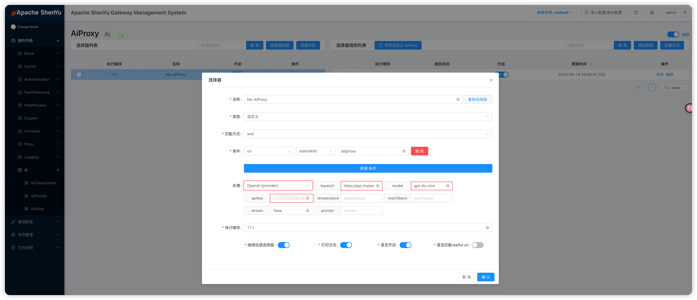
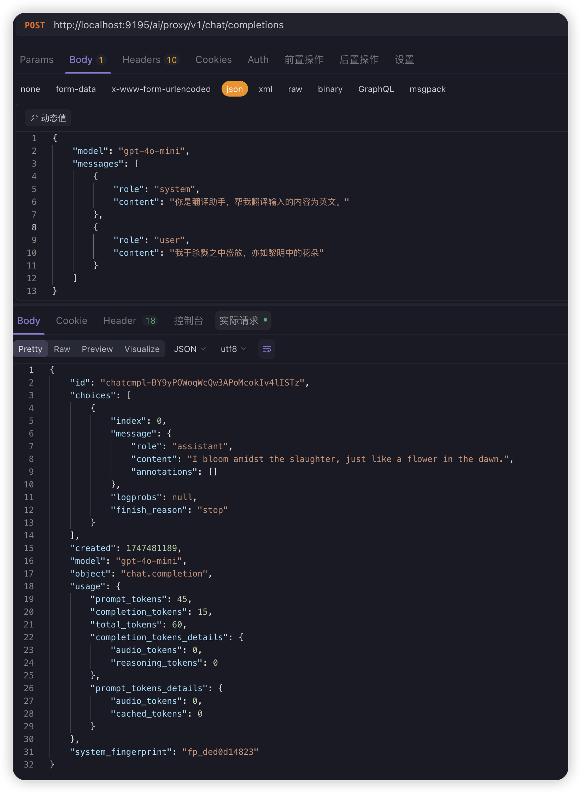

## 说明

`aiProxy` 插件用于代理大模型请求。客户端将请求发送到 ShenYu 网关后，插件会根据选择器中配置的 `provider`、`baseUrl`、`model`、`apiKey` 等信息调用对应的大模型服务，并将响应返回给客户端。

该插件可用于代理 OpenAI 协议兼容服务、阿里云等大模型服务，也可以代理本地部署且协议兼容的大模型服务。

## 插件配置

在 ShenYu Admin 中启用 `aiProxy` 插件后，先创建选择器，用它匹配请求并配置上游模型。再在这个选择器下创建规则，指定哪些请求使用该配置。通用配置可参考[选择器和规则管理](../../user-guide/admin-usage/selector-and-rule)。

要运行下方的 API 示例，将选择器的匹配条件设为 `uri startsWith /ai/proxy`，并在选择器的「处理」区域填写以下字段。

| 字段 | 示例值 |
| --- | --- |
| `provider` | `OpenAI` |
| `baseUrl` | `https://api.openai.com` |
| `model` | `gpt-4o-mini` |
| `apiKey` | 你的上游 OpenAI API 密钥 |



在该选择器下启用一条规则，同样使用 `uri startsWith /ai/proxy` 作为匹配条件。规则的「处理」区域可以留空，aiProxy 会从命中的选择器的 `handle` 读取上游配置。

> 注意：如果匹配路径中包含网关前缀，还需要配置 `contextPath` 插件移除前缀并组装正确的调用地址。详情请参考 [contextPath 插件](../http-process/contextpath-plugin)。

## API 调用

启用插件后，可以向 ShenYu 网关发送大模型请求：

```bash
curl --location --request POST 'http://localhost:9195/ai/proxy/v1/chat/completions' \
  --header 'Content-Type: application/json' \
  --data-raw '{
    "model": "gpt-4o-mini",
    "messages": [
      {
        "role": "system",
        "content": "You are a translation assistant. Please translate the input content into English."
      },
      {
        "role": "user",
        "content": "I bloom amidst slaughter, like a flower at dawn."
      }
    ]
  }'
```



## Proxy API Key 管理

`aiProxy` 插件支持在 ShenYu Admin 中维护代理 API Key。每个代理 API Key 绑定到指定选择器，并映射到真实上游 API Key。

管理接口基础路径为 `/selector/{selectorId}/ai-proxy-apikey`：

| 方法 | 路径 | 说明 | 权限 |
| --- | --- | --- | --- |
| `POST` | `/selector/{selectorId}/ai-proxy-apikey` | 创建代理 API Key 映射 | `system:aiProxyApiKey:add` |
| `GET` | `/selector/{selectorId}/ai-proxy-apikey` | 分页查询代理 API Key 映射 | `system:aiProxyApiKey:list` |
| `PUT` | `/selector/{selectorId}/ai-proxy-apikey/{id}` | 更新代理 API Key 映射 | `system:aiProxyApiKey:edit` |
| `POST` | `/selector/{selectorId}/ai-proxy-apikey/batchDelete` | 批量删除映射 | `system:aiProxyApiKey:delete` |
| `POST` | `/selector/{selectorId}/ai-proxy-apikey/batchEnabled` | 批量启用或禁用映射 | `system:aiProxyApiKey:disable` |

当选择器配置中的 `proxyEnabled` 为 `true` 时，请求必须携带代理 API Key：

```text
X-API-KEY: <proxy-api-key>
```

代理模式开启后，真实上游 API Key 不会暴露给客户端。插件会在转发前根据代理 API Key 查找真实 API Key 并完成替换。
