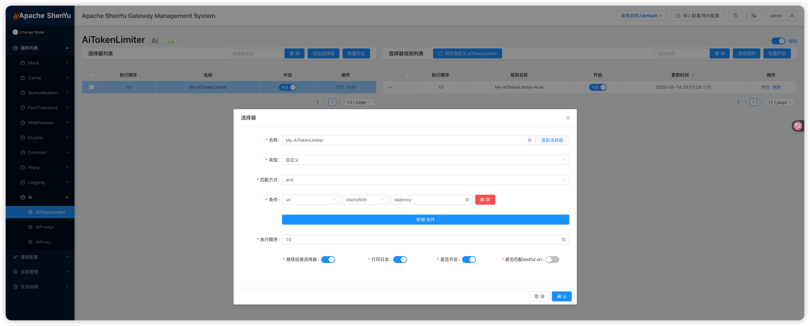
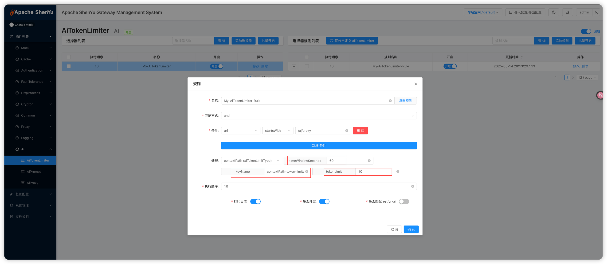
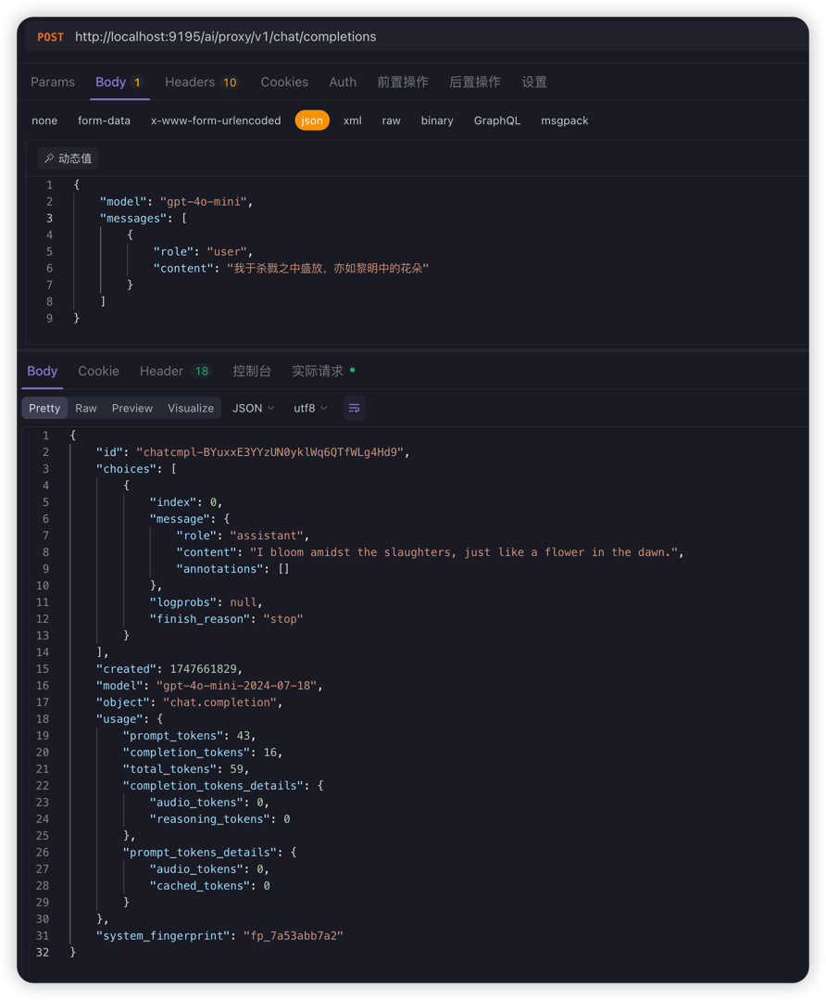
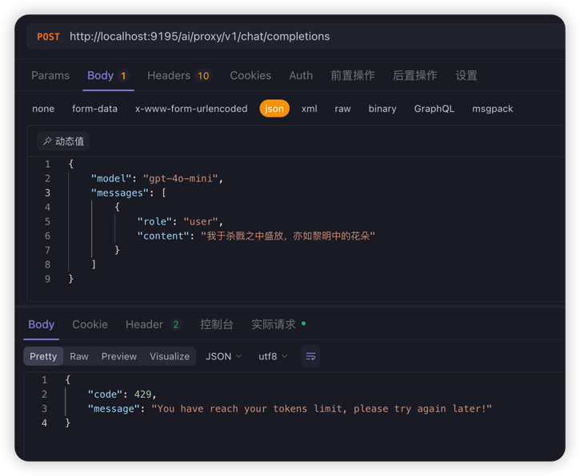

## 概述

`aiTokenLimiter` 从 LLM 响应中提取输出 Token 用量，并通过 Redis 按配置的用户或业务维度累计用量。达到窗口内的限制后，后续请求返回 HTTP 429。通常与 `aiProxy` 一起使用。

## 2.7.2 用量统计

插件读取提供者协议中的输出用量：Chat Completions 使用 `usage.completion_tokens`，Responses 使用 `usage.output_tokens`；Responses SSE 事件还支持 `response.usage`。元数据、生成文本、工具参数或 usage 对象之外的同名字段不计入用量。缺失或无效用量不会通过生成文本推算。流式解析支持跨分块的事件；对于需要显式开启用量输出的提供者，应在请求中设置 `stream_options.include_usage`。

请求转发前检查限制，响应返回后记录用量。因此它不会在生成过程中硬性截断输出，并发请求也可能在用量入账前完成。达到已记录的用量限制后，后续请求返回 HTTP 429。

## 插件与规则配置

在 Admin 中启用 `aiTokenLimiter` 和 `aiProxy`，配置插件的 Redis 连接，并创建[选择器和规则](../../user-guide/admin-usage/selector-and-rule.md)。

| 字段 | 含义 |
| --- | --- |
| `timeWindowSeconds` | 用量统计窗口，单位为秒。 |
| `aiTokenLimitType` | 提取限流维度的方式，例如 HEADER、PARAMETER、COOKIE。 |
| `keyName` | 与 `aiTokenLimitType` 配合使用的请求字段名。 |
| `tokenLimit` | 窗口内允许的输出 Token 数量。 |





需要注入提示词时，执行顺序为 `aiPrompt`、`aiTokenLimiter`、`aiProxy`。在插件管理中，将 `aiTokenLimiter` 的 `sort` 设得大于 `aiPrompt`、小于 `aiProxy`。

## 请求示例

```bash
curl --location --request POST 'http://localhost:9195/ai/proxy/v1/chat/completions' \
  --header 'Content-Type: application/json' \
  --data-raw '{
    "model": "gpt-4o-mini",
    "messages": [{"role": "user", "content": "Describe an API gateway."}]
  }'
```

先确认正常请求可以通过，并检查 Redis 中的用量累计。若窗口设为 60 秒、`tokenLimit` 设为 10，在提供者报告并记录至少 10 个输出 Token 后，再发送同一维度的请求，应收到 HTTP 429。测试时需确保请求包含规则要求的维度字段。





用量解析和失败处理以 [v2.7.2 插件实现](https://github.com/apache/shenyu/tree/v2.7.2/shenyu-plugin/shenyu-plugin-ai/shenyu-plugin-ai-token-limiter)为准。
