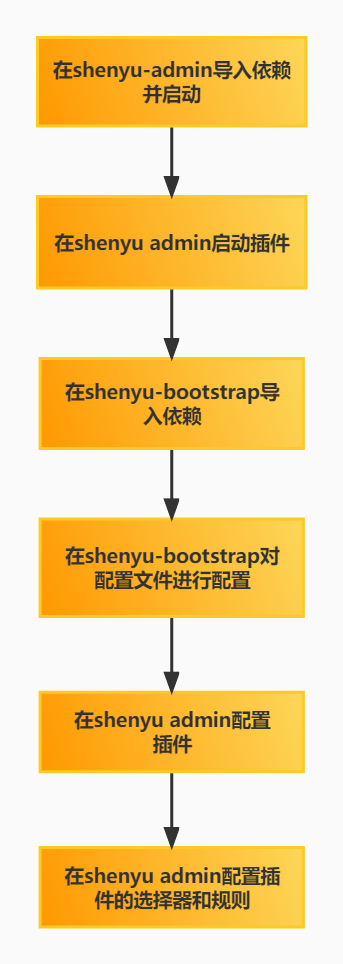
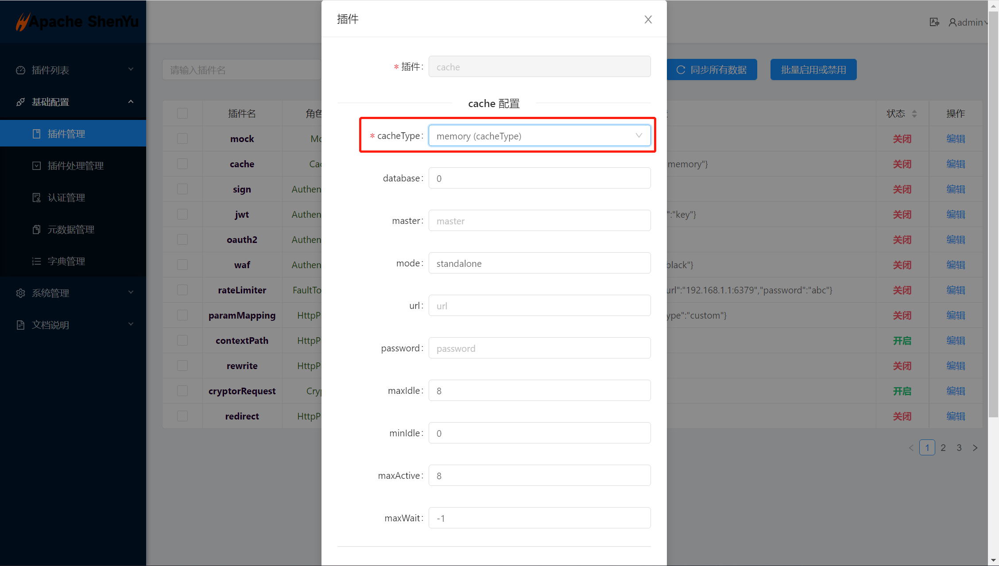

# 1. 概述

## 1.1 插件名称

* 缓存插件

## 1.2 适用场景

* 数据不会频繁更新，而且需要大量调用的场景。

* 对于数据一致性要求不高的场景。

## 1.3 插件功能

* `Cache`插件能够缓存目标服务的结果，允许用户配置缓存结果的失效时间。

## 1.4 插件代码

* 核心模块 `shenyu-plugin-cache-handler`.
* 核心模块 `shenyu-plugin-cache-redis`.
* 核心模块 `shenyu-plugin-cache-memory`.

* 核心类 `org.apache.shenyu.plugin.cache.CachePlugin`
* 核心类 `org.apache.shenyu.plugin.cache.redis.RedisCache`
* 核心类 `org.apache.shenyu.plugin.cache.memory.MemoryCache`

## 1.5 添加自哪个shenyu版本

* 2.4.3

# 2. 如何使用插件

## 2.1 插件使用流程图



## 2.2 导入pom

* 在`ShenYu Bootstrap`导入cache插件的依赖。

```xml
<!--shenyu cache plugin start-->
<dependency>
  <groupId>org.apache.shenyu</groupId>
  <artifactId>shenyu-spring-boot-starter-plugin-cache</artifactId>
  <version>${project.version}</version>
</dependency>
<!--shenyu cache plugin end-->
```

## 2.3 启用插件

在 `shenyu-admin` --> 基础配置 --> 插件管理 --> `Cache` 设置为开启。

## 2.4 配置插件

### 2.4.1 插件配置



* `cacheType`: Cache目前支持两种模式缓存数据

* memory：本地内存模式

* redis：redis模式

目前默认的是`本地内存模式`，目标服务的结果都存储在本地内存中，如果网关是通过集群的方式部署的，不建议使用`本地内存模式`，推荐使用`redis模式`，目标服务的数据都缓存到redis中。

如果使用的是`本地内存模式`，只需要在cacheType中选择memory即可，其他配置都不需要配置。

如果使用的是`redis模式`，在cacheType中选择redis，参数介绍：

* `database`：缓存结果存储到哪个数据库中，默认是索引库0。

* `master`：默认为master。

* `mode`：redis的工作模式，默认为单点模式：`standalone`，此外还有集群模式：`cluster`，哨兵模式：`sentinel`。

* `url` :配置 redis 数据库的IP和端口，通过冒号连接配置，示例：`192.168.1.1:6379`。

* `password`: redis 数据库的密码，如果没有的话，可以不配置。

* `maxldle`：连接池中最大空闲连接

* `minldle`：连接池中最小空闲连接

* `maxActive`：连接池最大连接数

* `maxWait`：连接池最大阻塞等待时间（使用负值表示没有限制）默认 -1

#### 合并并发缓存未命中请求（single-flight）

在 ShenYu 2.7.2 中，可在 `cache` 插件的配置 JSON 中设置以下字段。内存和 Redis 缓存均支持这些配置。

| 字段 | 默认值 | 含义 |
| --- | --- | --- |
| `singleFlightEnabled` | `false` | 同一个键的多个并发请求均未命中时，允许它们复用一次上游请求的可用响应。 |
| `singleFlightMaxKeys` | `1024` | 单个网关同时回填缓存的键数阈值。并发进入时可以短暂超过阈值。 |
| `singleFlightMaxWaiters` | `64` | 每个键允许等待的最大请求数。 |
| `singleFlightWaitTimeoutMillis` | `1000` | 等待其他请求回填缓存的最长时间，单位为毫秒。 |
| `singleFlightFillTimeoutMillis` | `30000` | 未完成的回填超过此时间后可释放占用的键，单位为毫秒。上游请求仍使用自己的超时。 |
| `singleFlightMaxResponseBytes` | `1048576` | 可共享给等待请求的编码响应包大小上限，单位为字节，包括缓存元数据和响应体。 |

每个网关独立合并并发请求，即使多个网关共享 Redis 也是如此。容量耗尽、等待超时、回填失败或取消、响应无法共享时，请求可以独立访问上游。`Vary` 匹配失败时也会独立访问上游。共享字节上限不限制响应缓冲大小、缓存条目大小或网关堆内存。

### 2.4.2 选择器配置

* 选择器和规则设置，请参考：[选择器和规则管理](../../user-guide/admin-usage/selector-and-rule)

### 2.4.3 规则配置

| 规则字段 | 默认值 | 含义 |
| --- | --- | --- |
| `timeoutSeconds` | `60` | 响应缓存的有效期，单位为秒。 |

### 2.4.4 缓存准入和响应复用

符合条件的请求必须命中缓存选择器和规则，并且是无请求体的 `GET`。非空请求体、传输编码，以及包含以下任一请求头的请求都会绕过缓存：

- `Authorization`、`Cookie` 或 `Range`
- `If-Match`、`If-None-Match`、`If-Modified-Since`、`If-Unmodified-Since` 或 `If-Range`
- `Cache-Control` 或 `Pragma`

这些请求会继续经过网关。范围请求和条件重验证由上游处理。即使请求头没有表明存在请求体，插件也会检查实际请求流，并把找到的请求体交给后续插件。

ShenYu 2.7.2 将请求方法、完整的原始 URI（包括查询参数）、选择器 ID 和规则 ID 一起用于生成带版本的缓存键。缓存条目同时存储完整响应的状态码、端到端响应头和响应体。逐跳响应头（包括 `Connection` 指定的头）不参与存储，回放时网关会设置合适的 `Content-Length`。请为有限的 HTTP 响应配置该插件。

状态码低于 200 或为 206、304 的响应、设置 Cookie 的响应，以及 `Cache-Control` 含 `private`、`no-store` 或 `no-cache` 的响应都不会缓存。其他满足条件的状态码可以缓存。`Vary: *` 响应也不会缓存。对于其他 `Vary` 值，条目会保存相关请求头的值，后续请求必须携带相同的值才会命中。每个键只保存一份响应，因此另一种变体的可缓存响应可以替换已有条目。

从旧版仅存储响应体的格式升级时，新键从空缓存开始。Redis 中的旧条目可以按原有有效期自然过期，无需迁移键。

## 2.5 示例

在测试网关中为 `/http/catalog` 等路由配置匹配的缓存选择器和规则。选择一个返回可缓存响应、能统计请求次数的上游服务，通过日志或计数判断网关是否访问上游。每轮验证使用新的查询参数值，确保第一次访问未命中缓存。

### 缓存命中和绕过

```shell
url='http://localhost:9195/http/catalog?id=123'
curl -sS "$url"
curl -sS "$url"
curl -sS -H 'Authorization: Bearer example' "$url"
curl -sS -X POST -H 'Content-Type: application/json' --data-binary '{"id":123}' "$url"
```

第一条响应写入缓存后，第二个无请求体的 GET 可以命中缓存。带 Authorization 请求头的请求和带请求体的 POST 都会访问上游。

### 验证两种响应变体

让上游返回对应语言的响应体，并设置 `Vary: Accept-Language`。使用一个新的缓存键。

```shell
variant_url="$url&case=vary"
curl -sS -H 'Accept-Language: en' "$variant_url"
curl -sS -H 'Accept-Language: en' "$variant_url"
curl -sS -H 'Accept-Language: fr' "$variant_url"
```

英文响应写入后，第二个英文请求可以命中缓存。法文请求无法复用英文响应，会访问上游。如果法文响应可缓存，就可以替换该键下的英文响应。

### 合并并发未命中请求

在插件配置中启用 `singleFlightEnabled`，让上游大约在 500 毫秒后返回响应，然后向同一个网关并发发送两个命中相同规则但未命中缓存的请求。使用新键和默认等待超时。

```shell
cold_url="$url&case=concurrent"
curl -sS -o /dev/null "$cold_url" &
curl -sS -o /dev/null "$cold_url" &
wait
```

两个请求重叠且上游响应可复用时，上游计数应增加一次。要观察独立回退，换一个新键，并把 `singleFlightWaitTimeoutMillis` 设为 `50`。等待请求超时后可以独立访问上游，因此上游计数可能增加两次。

# 3. 如何禁用插件

在 `shenyu-admin` --> 基础配置 --> 插件管理 --> `Cache` 设置为关闭。
