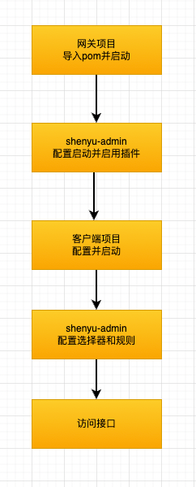
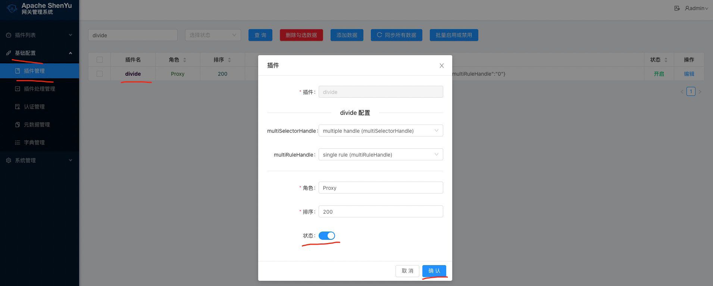
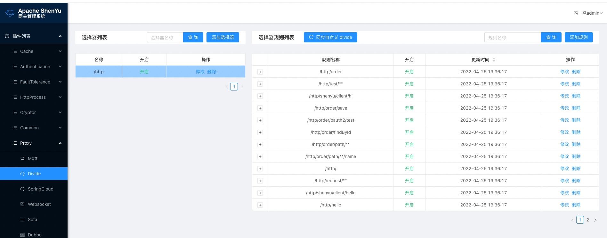
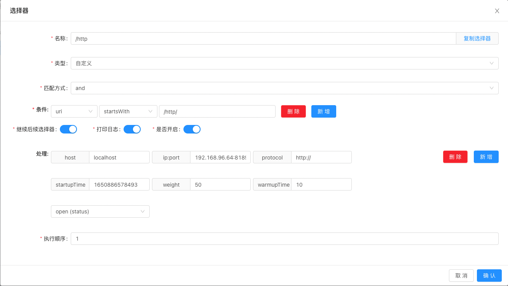
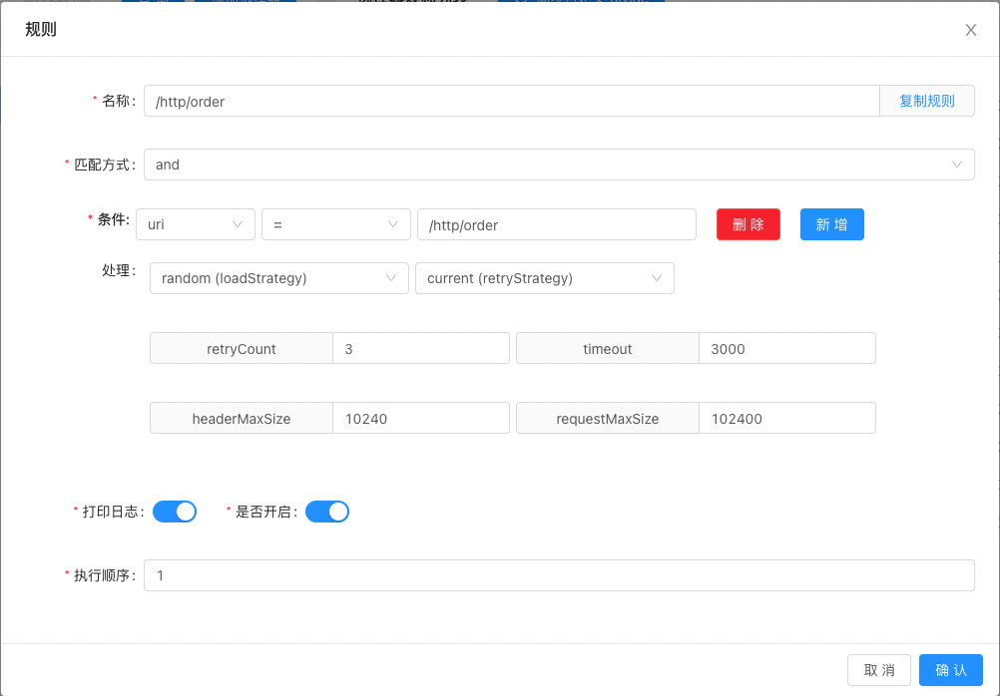
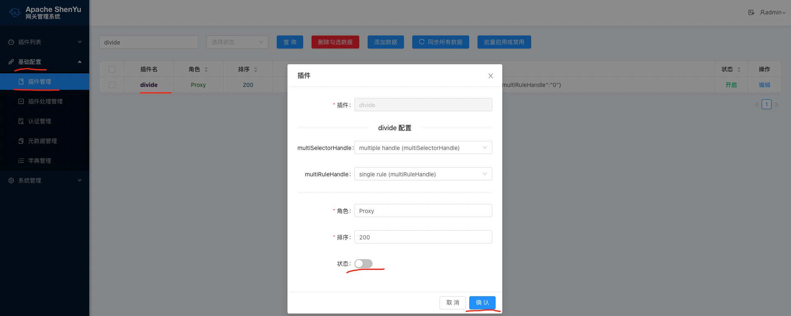

# 1. 概述

## 1.1 插件名称

* `divide`插件

## 1.2 适用场景

* 处理 `http协议` 请求
* 支持流量治理，例如a/b 测试、灰度测试
* 服务负载均衡
* 设置接口的超时时间

## 1.3 插件功能

* 支持根据 uri、header、query 等请求信息做流量的治理
* 支持设置请求的负载均衡策略，同时支持服务预热，目前支持三种策略：ip hash（带虚拟节点的一致性哈希）、round-robbin（加权轮询）、random（加权随机）
* 支持设置接口级别请求头最大值、请求体最大值、请求超时时间
* 支持设置超时重试策略和重试次数，目前重试策略支持：current（重试之前失败的服务器）和failover（重试其它服务器）

## 1.4 插件代码

* 核心模块 ```shenyu-plugin-divide```
* 核心类 ```org.apache.shenyu.plugin.divide.DividePlugin```

# 2. 如何使用插件

## 2.1 插件使用流程图



## 2.2 导入 pom

- 在网关的 `pom.xml` 文件中添加插件 maven 配置。

```xml
  <dependency>
      <groupId>org.apache.shenyu</groupId>
      <artifactId>shenyu-spring-boot-starter-gateway</artifactId>
     <version>${project.version}</version>
  </dependency>
```

## 2.3 启用插件

- 在 `shenyu-admin` --> 基础配置 --> 插件管理 --> `divide` 设置为开启。



## 2.4 配置插件

### 2.4.1 在客户端项目配置文件中配置接入参数

  * 客户端接入方式和服务器地址，下面的示例使用了 http 接入方式，目前客户端支持的接入的方式有以下几种：http、zookeeper、etcd、nacos、consul，详细的接入配置参数请参考[客户端接入配置](../../user-guide/property-config/register-center-access.md)。
  * 客户端配置，包含协议名称以及服务的路由地址，这里请使用 http 协议，并且必须配置 contextPath 的值作为每个服务的路由地址。
  
```yaml
  shenyu:
    register:
      registerType: http
      serverLists: http://localhost:9095
      props:
        username: admin
        password: 123456
    client:
      http: # http 协议
        props:
          contextPath: /http # 每个服务的路由地址
```      

### 2.4.2 在 shenyu-admin 配置文件中配置 upstream 有效性的检测参数

下面的示例使用了 http 接入方式，目前客户端支持的接入的方式有以下几种：http、zookeeper、etcd、nacos、consul，详细的接入配置参数请参考[客户端接入配置](../../user-guide/property-config/register-center-access.md)。

> 只有 http 类型的注册中心才支持 upstream 检测

```yaml
  shenyu:
    register:
      registerType: http # 只有 http 类型的注册中心才支持检测 upstream
      serverLists: 
      props:
        checked: true # 默认为 ture，设置为 false，不检测
        zombieCheckTimes: 5 # 僵尸 upstream 最大检测次数，超过 5 次不再检测其有效性，默认为 5
        scheduledTime: 10 # 定时检测时间间隔，默认 10 秒
        zombieRemovalTimes: 60 # upstream 多少秒不在线认定为僵尸 upstream，默认 60 秒
```

### 2.4.3 在 shenyu-admin 配置 divide 插件的选择器和规则信息

客户端启动之后会在 shenyu-admin -> 插件列表 -> Proxy -> Divide 自动注册[选择器和规则](../../user-guide/admin-usage/selector-and-rule)信息。


#### 2.4.3.1 选择器的配置

divide 选择器示例，通用选择器配置请参考[选择器和规则](../../user-guide/admin-usage/selector-and-rule)。



##### 2.4.3.1.1 选择器处理信息配置

- `host`：填写 `localhost`，该字段暂时没使用。
- `ip:port`：`ip` 与端口，这里填写你真实服务的 `ip` + 端口。
- `protocol`：：`http` 协议，填写 `http://` 或者 `https://`，不填写默认为：`http://`
- `startupTime`： 启动时间，单位毫秒。
- `weight`：负载均衡权重，服务启动自动注册的默认值为 50。
- `warmupTime`：预热时间，单位毫秒，在预热中的服务器会计算瞬时权重，计算值会小于实际配置的权重，以保护刚启动的服务器，服务启动注册的默认值为 10。举个例子预热时间 100 毫秒，目前启动了 50 毫秒，配置的权重 50， 实际的权重是 25。
- `status`：开启或关闭，开始状态此处理器才有效。

#### 2.4.3.2 规则的处理信息配置

divide 规则示例，通用规则配置请参考[选择器和规则](../../user-guide/admin-usage/selector-and-rule)。



##### 2.4.3.2.1 规则处理信息配置

- `loadStrategy`：如果`http`客户端是一个集群，`Apache ShenYu`网关调用时采取哪种负载均衡策略，当前支持 `roundRobin`、`random` 和 `hash`。
- `timeout`：调用`http`客户端的单次尝试超时时间，单位毫秒，默认值为 `3000`。一次尝试覆盖等待响应和读取响应的全过程，因此慢于该值的响应会被这个期限截断，而不是等到传输层的读取超时。
- `retryCount`：调用`http`客户端失败后的重试次数，默认值为 `3`。可重试的失败包括各类超时（建连、读取、单次尝试）和连接级传输错误；数据缓冲区超限错误不会被重试。
- `headerMaxSize`：请求`header`的最大值。
- `requestMaxSize`：请求体的最大值。
- `retryStrategy`：从`2.4.3版本`开始支持，失败后的重试策略，默认`current`以保持对低版本的兼容。 比如下游有3个服务`http://localhost:1111`、`http://localhost:1112`和`http://localhost:1113`，假设第一次负载均衡到`http://localhost:1111`并且`调用失败`。使用`current`策略会继续重试调用`http://localhost:1111`；使用`failover`策略会通过`负载均衡`重试调用到其他服务如`http://localhost:1112`，此时如果又失败了，则调用到`http://localhost:1113`，直到没有可用的服务为止。
- `retryBackOffSpec`：重试之间的退避策略，默认为 `default`。`default` 使用带上限的随机退避（最小 20 毫秒、上限 20 秒、抖动 0.5）；`fixed` 使用固定 2 秒延迟；`exponential` 使用从 500 毫秒起、上限 5 秒的指数退避。
- `requestTimeout`：可选。设置后它约束整个重试序列——所有尝试、之间的退避以及响应写回，期限到期时返回 `HTTP 504`。未设置时，序列仍有一个隐式的总预算 `(retry + 1) * timeout + retry * maximumBackoff` 作为兜底，其中 `maximumBackoff` 是所选 `retryBackOffSpec` 的退避上限（`default` 为 20 秒、`fixed` 为 2 秒、`exponential` 为 5 秒）；超出该预算同样会使整个序列失败。
- `poolGroup`：可选。选择 `shenyu.httpclient.pool-groups` 定义的命名连接池（见网关属性配置页）。未知的分组名称会返回 `HTTP 503`，而不会回退到共享的默认连接池。

重试次数耗尽与总预算耗尽的状态码不同：允许的尝试次数用尽时，客户端返回 `HTTP 408`（"超过最大重试次数"）；而整个序列的预算或 `requestTimeout` 先到期时返回 `HTTP 504`。带预算的重试同时计入单次尝试期限和总上限，而不是把某个超时值简单地按次数相乘。

普通请求与慢速流的对照示例，以及是哪个控制项结束了响应：

* 默认配置下，普通快速请求的每一次尝试都受规则 `timeout`（3000 毫秒）约束。如果每次尝试都挂起，尝试超时后会按配置的次数重试，次数用尽后以 `HTTP 408` 结束；如果总预算先耗尽，则以 `HTTP 504` 结束。
* 慢速流式响应（SSE、长轮询）即使一直有数据产出，达到单次尝试的总时长 `timeout` 后仍会被期限截断。代理这类上游时，应放大规则的 `timeout`（并可用 `requestTimeout` 约束整个序列）。仅把 `shenyu.httpclient.responseTimeout` 设为 0 并没有帮助：`responseTimeout` 约束的是响应读取之间的间隔（包括响应体），禁用它之后，传输层的读取期限（`shenyu.httpclient.readTimeout` 与各 idle 阈值）和规则侧的期限仍会终止停滞或过长的流。

## 2.5 示例

### 2.5.1 示例 A/B 测试

待补充

### 2.5.2 示例 灰度测试

待补充

# 3. 如何禁用插件

- 在 `shenyu-admin` --> 基础配置 --> 插件管理 --> `divide` 设置为禁用。


