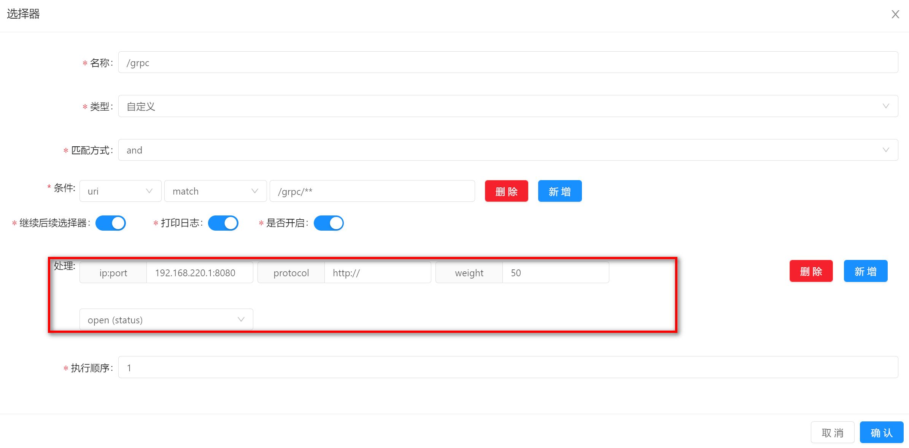
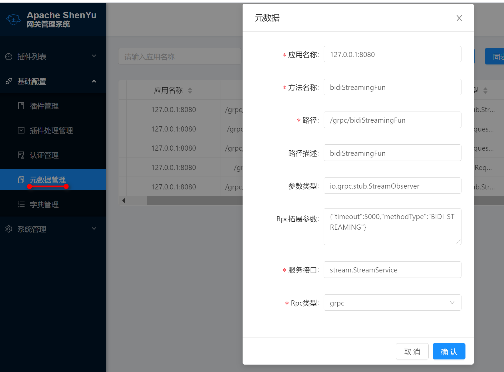

## 说明

`grpc` 插件将 HTTP/JSON 请求桥接到 gRPC 后端上的 ShenYu JSON 服务适配器。后端通过 ShenYu gRPC 客户端 starter 和 `@ShenyuGrpcClient` 暴露适配器并注册方法元数据。网关调用适配器的 JSON 服务描述符，例如 `stream.StreamServiceJSON/unaryFun`。

### HTTP 桥接行为 {#http-bridge-behavior}

| 后端方法类型 | HTTP 请求体 | 成功时的 HTTP 响应 |
| --- | --- | --- |
| 一元调用 | `data` 数组内的一条消息 | 含一条结果的 JSON 数组 |
| 服务端流式 | `data` 数组内的一条消息 | 汇总为一个 JSON 数组的多条结果 |
| 客户端流式 | `data` 数组内的多条消息 | 含后端单条结果的 JSON 数组 |
| 双向流式 | `data` 数组内的多条消息 | 汇总为一个 JSON 数组的多条结果 |

网关会先读完整个 HTTP 请求体，再向后端发送输入消息。即使后端已经产生结果，网关也要等 gRPC 调用结束才返回成功的 HTTP 响应。请使用有限的流，并让 gRPC 截止时间覆盖整个调用。客户端要等调用结束才能收到第一条结果，网关在等待期间会把结果保留在内存中。

HTTP 桥接不支持实时双向交互、无限订阅、SSE、NDJSON、gRPC-Web，也不接受 `grpcurl` 等工具发起的原生 gRPC 调用。独立的[原生 gRPC 代理](https://github.com/apache/shenyu/issues/8184)目前是提案。HTTP 桥接仍使用 `grpc` 插件标识。

### 响应汇总上限 {#aggregate-response-limits}

在 ShenYu 2.7.2 中，打开 Admin 的 **grpc 插件配置**，在配置 JSON 中添加以下字段。上限按单次调用计算。字段省略、值为 null、零或负数时，对应维度不限。

```json
{
  "maxAggregatedResultCount": 100,
  "maxAggregatedResultBytes": 1048576
}
```

- `maxAggregatedResultCount` 限制保留的响应条数。
- `maxAggregatedResultBytes` 限制保留的 JSON 载荷的 UTF-8 字节数。它不代表 gRPC 传输字节数、最终 HTTP 响应体大小或网关堆内存占用。

超过任一上限时，网关丢弃已汇总的结果并取消 gRPC 调用。HTTP 请求失败，不会返回部分成功结果。可按[快速开始](../../quick-start/quick-start-grpc.md#finite-streaming-examples)运行有限流并触发条数上限。

## 插件设置

* 引入相关依赖，开启插件，请参考：[gRPC快速开始](../../quick-start/quick-start-grpc) 。

* `gRPC`应用客户端接入，请参考：[gRPC服务接入](../../user-guide/proxy/grpc-proxy.md) 。

* 自`2.4.3版本`起grpc插件新增字段及含义：

  * `threadpool`：业务线程池类型，有`cached`和`shared`共2种类型。
    
    `cached`相当于grpc官方提供的默认线程池；
    
    `shared`线程池，正如其名，`所有proxy插件`共用一个`shared`线程池，这样做的好处是能够减少线程池数量，进而降低内存、提高资源利用率。


## 插件讲解


客户端接入`Apache ShenYu`网关后，会自动注册选择器和规则信息，可以在插件列表 `->` rpc proxy `->` grpc 中查看。 关于选择器和规则配置，请参考：[选择器和规则管理](../../user-guide/admin-usage/selector-and-rule)。


#### 选择器处理




选择器处理，即`handle`字段，是网关匹配到流量以后，可进行的处理操作。

* 处理配置详解：


  * `ip:port`：`ip` 与端口，这里填写你真实服务的 `ip` + 端口。

  * `protocol`：`http` 协议，一般填写 `http://` 或者 `https://` ，不填写默认为:`http://`
       
  * `weight`：服务权重。
     
  * `status`：开启或关闭。


## 元数据

每一个`grpc`接口方法，都会对应一条元数据，当`gRPC`应用客户端接入到`Apache ShenYu`网关时，会自动注册，可以在 `shenyu-admin`后台管理系统的基础配置 `-->` 元数据管理中查看。




* 应用名称：该条元数据所属的应用名称。

* 方法名称：需要调用的方法名。

* 路径：`http`请求路径。

* 路径描述：对该路径的说明，方便查看。

* 参数类型：`grpc`接口的参数类型列表，按照接口的参数类型顺序，通过半角逗号分隔。

* Rpc扩展参数：`grpc`接口的其他配置，支持`json`格式，字段如下：

```json
{
  "timeout": 5000,
  "methodType": "BIDI_STREAMING"
}
```

* 服务接口：`grpc`接口的全限定类名

* `Rpc`类型：此处选择 `grpc`。
