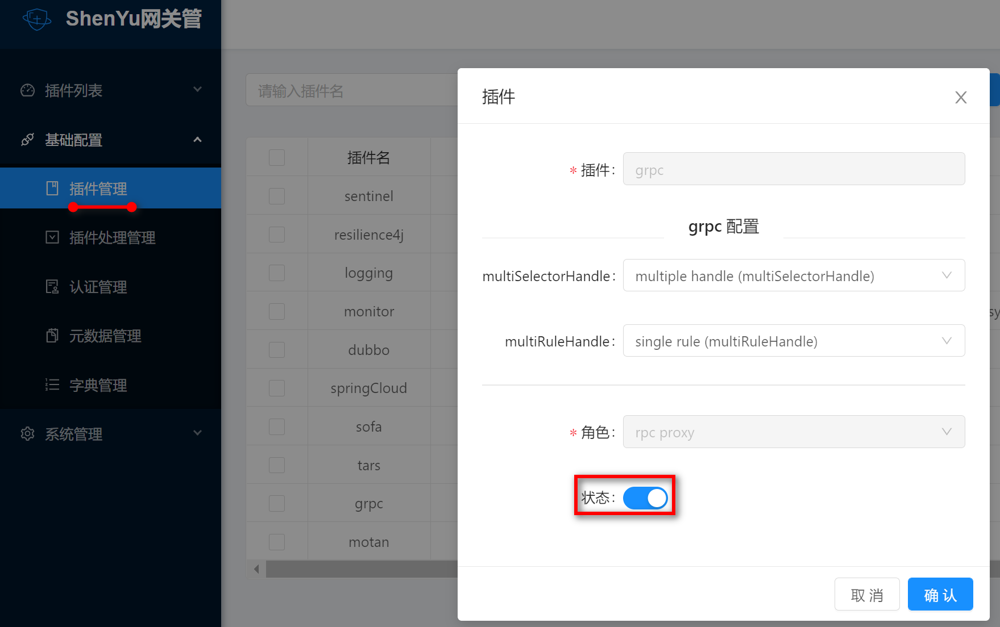
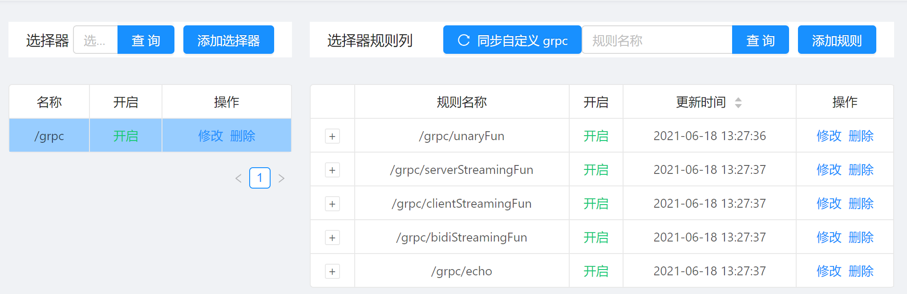
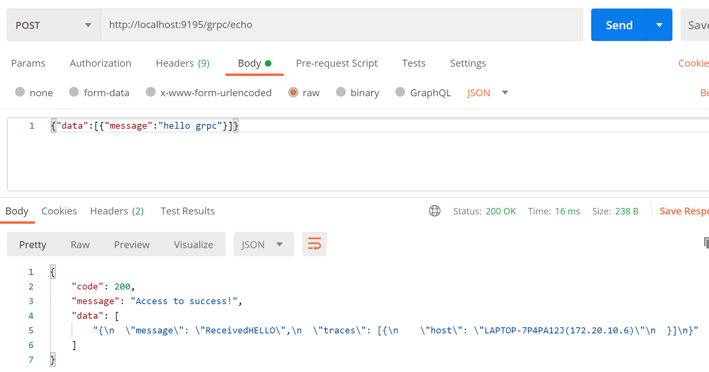

本文档演示如何将`gRPC`服务接入到`Apache ShenYu`网关。您可以直接在工程下找到本文档的 [示例代码](https://github.com/apache/shenyu/tree/v2.7.2/shenyu-examples/shenyu-examples-grpc) 。

## 环境准备

请参考运维部署的内容，选择一种方式启动`shenyu-admin`。比如，通过 [本地部署](../deployment/deployment-local) 启动`Apache ShenYu`后台管理系统。

启动成功后，需要在基础配置`->`插件管理中，把`gRPC` 插件设置为开启。



启动网关，如果是通过源码的方式，直接运行`shenyu-bootstrap`中的`ShenyuBootstrapApplication`。

> 注意，在启动前，请确保网关已经引入相关依赖。

引入网关对`gRPC`的代理插件，在网关的 `pom.xml` 文件中增加如下依赖：

```xml
        <!-- apache shenyu grpc plugin start-->
        <dependency>
            <groupId>org.apache.shenyu</groupId>
            <artifactId>shenyu-spring-boot-starter-plugin-grpc</artifactId>
            <version>${project.version}</version>
        </dependency>
        <!-- apache shenyu grpc plugin end-->
```

## 运行 shenyu-examples-grpc 项目

在 [ShenYu 2.7.2 源码](https://github.com/apache/shenyu/tree/v2.7.2/shenyu-examples)中打开 `shenyu-examples` 目录。该标签中的示例工程仍引用 `2.7.3-SNAPSHOT`。在本地副本中将示例工程切换到已发布的 2.7.2 依赖，再构建并启动 gRPC 示例。

```shell
cd shenyu-examples
mvn versions:set -DnewVersion=2.7.2 -DgenerateBackupPoms=false
mvn -pl shenyu-examples-grpc -am package -DskipTests
java -jar shenyu-examples-grpc/target/shenyu-examples-grpc.jar
```

成功启动会有如下日志，表示将 `gRPC` 服务成功注册到 `shenyu-admin` 中。

```shell
2021-06-18 19:33:32.866  INFO 11004 --- [or_consumer_-19] o.a.s.r.client.http.utils.RegisterUtils  : grpc client register success: {"appName":"127.0.0.1:8080","contextPath":"/grpc","path":"/grpc/clientStreamingFun","pathDesc":"clientStreamingFun","rpcType":"grpc","serviceName":"stream.StreamService","methodName":"clientStreamingFun","ruleName":"/grpc/clientStreamingFun","parameterTypes":"io.grpc.stub.StreamObserver","rpcExt":"{\"timeout\":5000,\"methodType\":\"CLIENT_STREAMING\"}","enabled":true,"host":"172.20.10.6","port":8080,"registerMetaData":false} 
2021-06-18 19:33:32.866  INFO 11004 --- [or_consumer_-17] o.a.s.r.client.http.utils.RegisterUtils  : grpc client register success: {"appName":"127.0.0.1:8080","contextPath":"/grpc","path":"/grpc/echo","pathDesc":"echo","rpcType":"grpc","serviceName":"echo.EchoService","methodName":"echo","ruleName":"/grpc/echo","parameterTypes":"echo.EchoRequest,io.grpc.stub.StreamObserver","rpcExt":"{\"timeout\":5000,\"methodType\":\"UNARY\"}","enabled":true,"host":"172.20.10.6","port":8080,"registerMetaData":false} 
2021-06-18 19:33:32.866  INFO 11004 --- [or_consumer_-20] o.a.s.r.client.http.utils.RegisterUtils  : grpc client register success: {"appName":"127.0.0.1:8080","contextPath":"/grpc","path":"/grpc/bidiStreamingFun","pathDesc":"bidiStreamingFun","rpcType":"grpc","serviceName":"stream.StreamService","methodName":"bidiStreamingFun","ruleName":"/grpc/bidiStreamingFun","parameterTypes":"io.grpc.stub.StreamObserver","rpcExt":"{\"timeout\":5000,\"methodType\":\"BIDI_STREAMING\"}","enabled":true,"host":"172.20.10.6","port":8080,"registerMetaData":false} 
2021-06-18 19:33:32.866  INFO 11004 --- [or_consumer_-21] o.a.s.r.client.http.utils.RegisterUtils  : grpc client register success: {"appName":"127.0.0.1:8080","contextPath":"/grpc","path":"/grpc/unaryFun","pathDesc":"unaryFun","rpcType":"grpc","serviceName":"stream.StreamService","methodName":"unaryFun","ruleName":"/grpc/unaryFun","parameterTypes":"stream.RequestData,io.grpc.stub.StreamObserver","rpcExt":"{\"timeout\":5000,\"methodType\":\"UNARY\"}","enabled":true,"host":"172.20.10.6","port":8080,"registerMetaData":false} 
2021-06-18 19:33:32.866  INFO 11004 --- [or_consumer_-18] o.a.s.r.client.http.utils.RegisterUtils  : grpc client register success: {"appName":"127.0.0.1:8080","contextPath":"/grpc","path":"/grpc/serverStreamingFun","pathDesc":"serverStreamingFun","rpcType":"grpc","serviceName":"stream.StreamService","methodName":"serverStreamingFun","ruleName":"/grpc/serverStreamingFun","parameterTypes":"stream.RequestData,io.grpc.stub.StreamObserver","rpcExt":"{\"timeout\":5000,\"methodType\":\"SERVER_STREAMING\"}","enabled":true,"host":"172.20.10.6","port":8080,"registerMetaData":false} 
```

## 简单测试

`shenyu-examples-grpc`项目成功启动之后会自动把加 `@ShenyuGrpcClient` 注解的接口方法注册到网关。

打开 `插件列表 -> rpc proxy -> grpc` 可以看到插件规则配置列表。




下面使用 `postman` 模拟 `http` 的方式来请求你的 `gRPC` 服务。
请求参数如下：

```json
{
    "data": [
        {
            "message": "hello grpc"
        }
    ]
}
```



当前是以 `json` 的格式传递参数，`key`的名称默认是`data`，你可以在 `GrpcConstants.JSON_DESCRIPTOR_PROTO_FIELD_NAME` 中进行重置；`value`的传入则根据你定义的 `proto` 文件。

## 有限流调用示例 {#finite-streaming-examples}

示例应用注册其 ShenYu JSON 服务适配器后，向网关发送 HTTP/JSON 请求。网关会读完 `data` 数组中的所有消息，再向后端发送。每个成功的请求都会在 gRPC 调用完成后返回一个 JSON 数组。

```shell
gateway=http://localhost:9195
one='{"data":[{"text":"hello"}]}'
two='{"data":[{"text":"hello"},{"text":"again"}]}'

curl -sS -H 'Content-Type: application/json' -d "$one" "$gateway/grpc/unaryFun"
curl -sS -H 'Content-Type: application/json' -d "$two" "$gateway/grpc/clientStreamingFun"
curl -sS -H 'Content-Type: application/json' -d "$one" "$gateway/grpc/serverStreamingFun"
curl -sS -H 'Content-Type: application/json' -d "$two" "$gateway/grpc/bidiStreamingFun"
```

一元调用返回一条 `{"text":"unaryFun response: hello gRPC"}`，客户端流式调用返回一条完成消息。服务端流式调用一次返回含十条结果的数组。此处双向流式调用的两条输入会收到三条结果，每条输入对应一条结果，最后还有一条完成消息。

验证上限时，先确认服务端流式请求能返回十条结果。然后在 Admin 当前命名空间的 `grpc` 插件配置 JSON 中设定 `"maxAggregatedResultCount": 5`。等配置同步后再次发起请求，默认的 2.7.2 网关会返回 HTTP 500，不会返回部分结果。恢复原条数配置，再用 `"maxAggregatedResultBytes": 140` 验证字节上限。最后恢复原配置，确认响应重新包含十条结果。字段单位和默认行为见[响应汇总上限](../plugin-center/proxy/grpc-plugin.md#aggregate-response-limits)。
