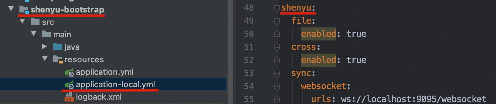

本篇主要讲解如何在 `Apache Shenyu` 网关配置 `ShenYu` 的相关属性。



### 属性配置

```yaml
shenyu:
  # 下列匹配缓存配置仅适用于当前开发线；ShenYu 2.7.1 及更早版本使用的是已移除的前缀树 L2 缓存
  selectorMatchCache:
    ## 选择器按路径的有界匹配缓存
    cache:
      enabled: true
      initialCapacity: 10000 # initial capacity in cache
      maximumSize: 10000 # max size in cache
      ttl: 60000 # match result lifetime in milliseconds, must be positive
  ruleMatchCache:
    ## 规则按路径的有界匹配缓存
    cache:
      enabled: true
      initialCapacity: 10000 # initial capacity in cache
      maximumSize: 10000 # max size in cache
      ttl: 60000 # match result lifetime in milliseconds, must be positive
  netty:
    http:
      webServerFactoryEnabled: true
      selectCount: 1
      workerCount: 4
      accessLog: false
      serverSocketChannel:
        soRcvBuf: 87380
        soBackLog: 128
        soReuseAddr: true
        connectTimeoutMillis: 30000
        writeBufferHighWaterMark: 65536
        writeBufferLowWaterMark: 32768
        writeSpinCount: 16
        autoRead: false
        allocType: "pooled"
        messageSizeEstimator: 8
        singleEventExecutorPerGroup: true
      socketChannel:
        soKeepAlive: false
        soReuseAddr: false
        soLinger: -1
        tcpNoDelay: true
        soRcvBuf: 87380
        soSndBuf: 16384
        ipTos: 0
        allowHalfClosure: false
        connectTimeoutMillis: 30000
        writeBufferHighWaterMark: 65536
        writeBufferLowWaterMark: 32768
        writeSpinCount: 16
        autoRead: false
        allocType: "pooled"
        messageSizeEstimator: 8
        singleEventExecutorPerGroup: true
  instance:
    enabled: false
    registerType: zookeeper #etcd #consul
    serverLists: localhost:2181 #http://localhost:2379 #localhost:8848
    props:
#  httpclient:
#    strategy: netty # 支持 webClient 或 netty，默认 netty
#    connectTimeout: 45000 # TCP 连接建立超时，单位毫秒
#    responseTimeout: 3000 # 作用于每个被代理响应的响应等待，单位毫秒；0 或负数表示禁用该等待
#    readerIdleTime: 3000 # 连接级 idle 处理器的读空闲阈值，单位毫秒
#    writerIdleTime: 3000
#    allIdleTime: 3000
#    readTimeout: 3000 # 单次读取期限，单位毫秒；非正值表示禁用该读取期限
#    writeTimeout: 3000 # 单次写入期限，单位毫秒
#    wiretap: false
#    keepAlive: true # 复用上游连接；false 是应对上游重置陈旧连接的兜底开关（reactor-netty#388）
#    pool:
#      type: FIXED # 支持 FIXED（默认）、ELASTIC（保留的历史名称，与 FIXED 使用相同的有限容量）或 DISABLED
#      name: shenyu-proxy # 默认连接池名称；按规则选用的池需通过 shenyu.httpclient.pool-groups 单独配置
#      maxConnections: 16 # 示例值；必须为正数，默认值沿用 Reactor Netty
#      acquireTimeout: 3000 # 等待池内连接的最长时间，单位毫秒；0 表示不等待，负数会在启动时报错
#      maxPendingAcquires: 32 # 缺省时为 2*maxConnections；-1 表示不限制队列；0 与小于 -1 的值会在启动时报错
#      maxIdleTime: # 缺省表示不做空闲回收；FIXED 池建议设为小于上游/负载均衡器的空闲超时
#      maxLifeTime:
#      evictionInterval:
#      metrics: false # 需要类路径上存在 micrometer-core
#    proxy:
#      host:
#      port:
#      username:
#      password:
#      nonProxyHostsPattern:
#    ssl:
#      useInsecureTrustManager: false
#      keyStoreType: PKCS12
#      keyStorePath: classpath:keystore.p12
#      keyStorePassword: 123456
#      keyStoreProvider:   
#      keyPassword: 123456
#      trustedX509Certificates:
#      handshakeTimeout:
#      closeNotifyFlushTimeout:
#      closeNotifyReadTimeout:
#      defaultConfigurationType:
  sync:
    websocket:
      urls: ws://localhost:9095/websocket
      allowOrigin: ws://localhost:9195
#    zookeeper:
#      url: localhost:2181
#      sessionTimeout: 5000
#      connectionTimeout: 2000
#    http:
#      url: http://localhost:9095
#    nacos:
#      url: localhost:8848
#      namespace: 1c10d748-af86-43b9-8265-75f487d20c6c
#      username:
#      password:
#      acm:
#        enabled: false
#        endpoint: acm.aliyun.com
#        namespace:
#        accessKey:
#        secretKey:
#    etcd:
#      url: http://localhost:2379
#    consul:
#      url: http://localhost:8500
#      waitTime: 1000
#      watchDelay: 1000
  cross:
    enabled: true
    allowedHeaders:
    allowedMethods: "*"
    allowedAnyOrigin: false
    allowedOrigin:
      # format : schema://prefix spacer domain
      # Access-Control-Allow-Origin: "http://a.apache.org,http://b.apache.org"
      spacer: "."
      domain: apache.org
      prefixes:
        - a # a.apache.org
        - b # b.apache.org
      origins:
        - c.apache.org
        - d.apache.org
        - http://e.apache.org
      originRegex: ^http(|s)://(.*\.|)abc.com$
    allowedExpose: ""
    maxAge: "18000"
    allowCredentials: true
  switchConfig:
    local: true
  file:
    enabled: true
    maxSize : 10
  exclude:
    enabled: false
    paths:
      - /favicon.ico
  fallback:
    enabled: false
    paths:
      - /fallback/hystrix
      - /fallback/resilience4j
  health:
    enabled: false
    paths:
      - /actuator/health
      - /health_check
  alert:
    enabled: true
    admins: localhost:9095
  extPlugin:
    path:
    enabled: true
    threads: 1
    scheduleTime: 300
    scheduleDelay: 30
  scheduler:
    enabled: false
    type: fixed
    threads: 16
  upstreamCheck:
    enabled: false
    timeout: 3000
    healthyThreshold: 1
    unhealthyThreshold: 1
    interval: 5000
    printEnabled: true
    printInterval: 60000
  ribbon:
    serverListRefreshInterval: 10000
  metrics:
    enabled: false
    name : prometheus
    host: 127.0.0.1
    port: 8090
    jmxConfig:
    props:
      jvm_enabled: true
  sharedPool:
    enable: true
    prefix: "shenyu-shared"
    corePoolSize: 200
    maximumPoolSize: 2000
    keepAliveTime: 60000
    maxWorkQueueMemory: 1073741824 # 1GB
    maxFreeMemory: 268435456 # 256MB
```

### 属性详解


##### shenyu.selectorMatchCache.cache 与 shenyu.ruleMatchCache.cache 配置

`shenyu.selectorMatchCache.cache` 与 `shenyu.ruleMatchCache.cache` 绑定到 `MatchCacheConfig`，分别为选择器匹配和规则匹配提供按路径的有界缓存。当前实现中不存在单独的 `shenyu.matchCache` 前缀，也不存在前缀树（trie）L2 缓存。

本节描述当前开发线（对照 `2.7.3-SNAPSHOT` 验证）。ShenYu 2.7.1 及更早版本提供的是基于前缀树的 L2 缓存；该版本实际支持的配置请见 [2.7.1 版本页](/zh/docs/2.7.1/user-guide/property-config/gateway-property-config)。

下表为 Java 模型默认值；具体的发行版样例可能覆盖这些值。

| 字段           | 类型    | 默认值 | 是否必填 | 说明       |
|-----------------|---------|---------|----------|-----------------------------------|
| enabled         | Boolean | true    | No       | 是否在选择器/规则匹配时查询按路径的有界匹配缓存。只有候选集合满足"仅由路径决定"的条件时才会写入缓存条目（见下文） |
| initialCapacity | int     | 10000   | No       | 匹配缓存初始化容量 |
| maximumSize     | long    | 10000   | No       | 匹配缓存最大条目数 |
| ttl             | long    | 60000   | No       | 匹配结果存活时间，单位为**毫秒**，必须为正数；非正值会在属性绑定时抛出 `Match cache ttl must be positive` |

###### 哪些结果会被缓存

缓存条目以 `(插件名, 路径)` 为键，保存命中的选择器/规则，或"该路径没有候选命中"的负缓存条目。由于一次缓存命中会跳过整个候选集合，只有当匹配完全由请求路径决定时才会写入条目：

* 所有启用的候选选择器/规则的条件都是 URI 类型，且使用以下仅路径安全的操作符之一：`=`、`equals`、`contains`、`startsWith`、`endsWith`、`match`、`regex`、`exclude`、`pathPattern`、`isBlank`。
* 没有任何启用的候选被标记为 `matchRestful`，且不存在条件列表为空的候选（例如全流量匹配选择器）——这类候选始终实时匹配，不会产生缓存条目。
* 正向条目还要求恰好只有一个候选命中：当同一请求有两个及以上候选命中时，仍会按条件数和排序选出胜者，但该结果不会写入缓存。
* 规则负缓存条目的键中不包含选择器 id，因此只有当该插件的整个选择器集合同样由路径决定时，负缓存才是安全的。

依赖请求头、查询参数、Cookie、IP/域名、时间相关谓词或自定义 SPI 操作符的条件取决于 URI 之外的状态，不满足缓存条件：这类匹配每次请求都会实时执行。这是实现上的安全限制，而不是对"看似 URI 规则"的一般性建议。

举例：如果选择器的条件只有 `uri` 类型的 `pathPattern /api/**`，它是可缓存的——匹配结果完全取决于请求路径。而如果选择器还额外依赖请求头条件（如 `X-Token: abc`），则不可缓存，因为同一路径携带不同请求头的两个请求可能得到不同的匹配结果。请注意，是否可以缓存取决于整个候选集合，而不只是命中的那条规则：路径键的缓存命中会跳过所有候选，因此只有当所有启用的候选都不依赖路径之外的状态时，才会写入缓存。

###### 过期与配置变更

缓存条目最多存活 `ttl` 毫秒（默认 60 秒），过期后由下一次匹配请求按当前的选择器/规则数据重新计算。配置变更不会被即时推送到运行中网关的匹配缓存：每个网关节点都会从自己的缓存对外服务，直到条目过期，因此可以把 `ttl` 视为匹配结果可能过期的上界。这些缓存条目不会跨网关节点同步。

###### 旧版本（移除前）升级说明

ShenYu 2.7.1 及更早版本提供通过 `shenyu.selectorMatchCache.trie.*` 与 `shenyu.ruleMatchCache.trie.*`（`enabled`、`cacheSize`、`matchMode`）配置的前缀树 L2 缓存。这些配置段和前缀树引擎在当前实现中已不存在：默认的属性绑定会忽略这些残留键，它们不会恢复前缀树匹配。请移除它们并改用上文中的 `shenyu.selectorMatchCache.cache` / `shenyu.ruleMatchCache.cache`。


##### shenyu.NettyTcpProperties 配置

Apache ShenYu reactor-netty 配置

| 名称                          | 类型    | 默认值 | 是否必填 | 说明                                                          |
|:------------------------------|:----- |:-------:|:--------:|:------------------------------------------------------------|
| webServerFactoryEnabled       | Boolean |  true   |    否    | 是否开启自定义参数，true-开启，false-可以自行配置NettyReactiveWebServerFactory |
| selectCount                   | Integer |    1    |    否    | Netty 选择器数                                                  |
| workerCount                   | Integer |    4    |    否    | Netty 工作线程数                                                 |
| accessLog                     | Boolean |  false  |    否    | netty request parameters.                                   |
| **ServerSocketChannelConfig** |  |         |          |                                                             |
| soRcvBuf                      | Integer | --        | 否       | Socket参数，TCP数据接收缓冲区大小，默认由系统决定            |
| soBackLog                     | Integer |   128   |    否    | Socket参数，服务端接受连接的队列长度                                       |
| soReuseAddr                   | Boolean | true      | 否       | Socket 参数，是否复用地址，reactor-netty中默认值为true       |
| connectTimeoutMillis          | Integer | 30000     | 否       | Netty 参数，连接超时时间                                     |
| writeBufferHighWaterMark      | Integer |  65536  |    否    | Netty 参数，通道水位线上限                                            |
| writeBufferLowWaterMark       | Integer |  32768  |    否    | Netty 参数，通道水位线下限                                            |
| writeSpinCount                | Integer |   16    |    否    | Netty参数，一个Loop写操作执行的最大次数                                    |
| autoRead                      | Boolean | false     | 否       | Netty参数，自动读取，reactor-netty中默认值为false，且只能为false |
| allocType                     | String  | pooled  |    否    | Netty参数，ByteBuf的分配器                                         |
| messageSizeEstimator          | Integer |    8    |    否    | Netty参数, 消息大小估算器, 用于估算ByteBuf,ByteBufHolder和FileRegion大小    |
| singleEventExecutorPerGroup   | Boolean |  true   |    否    | Netty参数, 单线程执行ChannelPipeline中的事件                           |
| **SocketChannelConfig**       |  |         |          |                                                             |
| soKeepAlive                   | Boolean |  false  |    否    | Socket 参数，是否启用心跳保活机制                                        |
| soReuseAddr                   | Boolean | true      | 否       | Socket 参数，是否复用地址，reactor-netty中默认值为true       |
| soLinger                      | Integer |   -1    |    否    | Socket 参数，关闭 Socket 的延迟时间                                   |
| tcpNoDelay                    | Boolean |  true   |    否    | Socket 参数，是否启用 Nagle 算法                                     |
| soRcvBuf                      | Integer | --        | 否       | Socket参数，TCP数据接收缓冲区大小，默认由系统决定            |
| soSndBuf                      | Integer | --        | 否       | Socket参数，TCP数据发送缓冲区大小，默认由系统决定            |
| ipTos                         | Integer |    0    |    否    | IP参数，设置IP头部的Type-of-Service字段，用于描述IP包的优先级和QoS选项             |
| allowHalfClosure              | Boolean |  false  |    否    | Netty参数，一个连接的远端关闭时本地端是否关闭                                   |
| connectTimeoutMillis          | Integer | 30000     | 否       | Netty 参数，连接超时时间                                     |
| writeBufferHighWaterMark      | Integer |  65536  |    否    | Netty 参数，通道水位线上限                                            |
| writeBufferLowWaterMark       | Integer |  32768  |    否    | Netty 参数，通道水位线下限                                            |
| writeSpinCount                | Integer |   16    |    否    | Netty参数，一个Loop写操作执行的最大次数                                    |
| autoRead                      | Boolean | false     | 否       | Netty参数，自动读取，reactor-netty中默认值为false，且只能为false |
| allocType                     | String | pooled  |    否    | Netty参数，ByteBuf的分配器                                         |
| messageSizeEstimator          | Integer |    8    |    否    | Netty参数, 消息大小估算器, 用于估算ByteBuf,ByteBufHolder和FileRegion大小    |
| singleEventExecutorPerGroup   | Boolean |  true   |    否    | Netty参数, 单线程执行ChannelPipeline中的事件                           |


##### shenyu.register 配置

Apache ShenYu 网关注册到注册中心的相关配置，注册中心配置请参考 [注册中心配置](register-center-instance.md) 

| 名称         |  类型   |     默认值     | 是否必填 | 说明                                      |
| :----------- | :-----: | :------------: | :------: | :---------------------------------------- |
| enabled      | boolean |     false      |    是    | 是否启动                                  |
| registerType | String  |   zookeeper    |    是    | 使用哪个注册中心，目前支持zookeeper、etcd |
| serverLists  | String  | localhost:2181 |    是    | 注册中心的地址。若使用集群，用 `,` 分隔   |
| props        |         |                |          | 使用不同注册类型时，属性取值不同。        |

- `props`配置

使用不同的注册中心时，属性取值不同

当注册类型为 `zookeeper` 时，支持的属性配置如下：

|名称                      | 类型  |  默认值   | 是否必填  | 说明                        |
|:------------------------ |:----- |:-------: |:-------:|:----------------------------|
|sessionTimeout                   | int |  30000      | 否     |session超时时间（毫秒）|
|connectionTimeout                | int |  3000    |  否  |连接超时时间（毫秒）|

当注册类型为 `etcd` 时，支持的属性配置如下：

|名称                      | 类型  |  默认值   | 是否必填  | 说明                        |
|:------------------------ |:----- |:-------: |:-------:|:----------------------------|
|etcdTimeout                   | int |  30000      | 否     |etcd超时时间（毫秒）|
|etcdTTL                | int |  5    |  否  |租约生存时间（秒）|


##### shenyu.httpclient 配置

Apache ShenYu 网关中代理Http及SpringCloud协议后，用于发送代理请求的HttpClient配置

下表为当前开发线的取值（对照 `2.7.3-SNAPSHOT` 验证）；旧版本实际发布的默认值请见对应版本的本指南页面。

| 名称            |  类型   |  默认值   | 是否必填 | 说明                                                         |
| :-------------- | :-----: | :-------: | :------: | :----------------------------------------------------------- |
| strategy        | String  | netty     |    No    | HttpClientPlugin实现策略（默认使用netty）：<br />- `webClient`：使用WebClientPlugin<br />- `netty`：使用NettyHttpClientPlugin |
| connectTimeout  |   int   |   45000   |    No    | TCP 连接建立超时时间 (毫秒)，默认值为 `45000`。该值只作用于建连阶段，与等待池内可用连接的 `pool.acquireTimeout` 不同。 |
| responseTimeout |   int   |   3000    |    No    | 响应等待时间 (毫秒)，默认值为 `3000`。它约束的是响应读取之间的间隔（包括响应体的读取），不只是等待响应头，因此 SSE、长轮询、token 流等在响应头到达之后仍可能超时。设为 `0` 或负数表示禁用该等待，此时下方的单次读取期限仍然生效。 |
| readerIdleTime  |   int   |   3000    |    No    | 连接级 idle 处理器的读空闲阈值 (毫秒)，默认值为 `3000`。     |
| writerIdleTime  |   int   |   3000    |    No    | 连接级 idle 处理器的写空闲阈值 (毫秒)，默认值为 `3000`。     |
| allIdleTime     |   int   |   3000    |    No    | 连接级 idle 处理器的双向空闲阈值 (毫秒)，默认值为 `3000`。   |
| readTimeout     |   int   |   3000    |    No    | 单次读取期限 (毫秒)，默认值为 `3000`。设为非正数时该读取期限被禁用，上方的 idle 阈值仍然生效。 |
| writeTimeout    |   int   |   3000    |    No    | 单次写入期限 (毫秒)，默认值为 `3000`。                       |
| wiretap         | Boolean |   false   |    No    | 启用 Netty HttpClient 的窃听调试，默认值为 `false`。         |
| keepAlive       | Boolean |   true    |    No    | 启用或禁用请求的 Keep-Alive 支持，默认值为 `true`。设为 `false` 是应对上游重置陈旧连接的兜底开关（reactor-netty#388）。启用 keep-alive 并使用 FIXED 池时，应把 `pool.maxIdleTime` 设为小于上游或负载均衡器的空闲超时，并为部署规模显式设置 `pool.maxConnections`。 |
| pool            |         |           |          | HttpClient 连接池配置                                        |
| poolGroups      |         |           |          | 可选的命名连接池分组（按规则选用），见下文。                  |
| proxy           |         |           |          | HttpClient 代理配置                                          |
| ssl             |         |           |          | HttpClient SSL配置                                           |

这些属性作用于不同层面，彼此叠加而非互相替代：`connectTimeout` 约束连接建立，`pool.acquireTimeout` 约束等待池内空闲连接，`responseTimeout` 与单次读/写期限约束已建立连接上的读写。整个代理尝试（含响应头与响应体）还会被代理规则侧的超时（见 `divide` 插件页的 `timeout` 与 `requestTimeout`）约束。因此对于慢速流式上游，通常还需要放大规则侧的期限——仅禁用 `responseTimeout` 并不能让停滞的流免于读取期限或规则期限的约束。

- `pool` config

HttpClient连接池配置。连接池按远端地址区分，因此 `maxConnections` 与队列上限按上游目标逐个生效，而不是全网关共享：

| 名称               |  类型   |            默认值            | 是否必填 | 说明                                                         |
| :----------------- | :----: | :--------------------------: | :------: | :----------------------------------------------------------- |
| type              | String |            FIXED             |    No    | HttpClient连接池类型，默认值为`FIXED`。<br /> - `FIXED`: 连接池缓存并重用，有固定的最大连接数。<br />- `ELASTIC`: 名称出于兼容保留；它不再代表无限容量，而是与 `FIXED` 遵循相同的有限容量限制，并在启动时打印包含实际生效值的警告日志。<br />- `DISABLED`: 不使用连接池，总是为每个请求创建新连接。 |
| name              | String |         shenyu-proxy         |    No    | 连接池映射名称，默认为`shenyu-proxy`。                        |
| maxConnections    |  int   |     Reactor Netty 默认值     |    No    | 进入排队获取之前的最大连接数，`FIXED` 与 `ELASTIC` 均适用。必须为正数，默认值沿用 Reactor Netty。 |
| acquireTimeout    |  long  |             3000             |    No    | 等待池内连接的最长时间（毫秒），`FIXED` 与 `ELASTIC` 均适用。`0` 表示不等待；负数会在启动时报错。 |
| maxPendingAcquires |  int  |       2 x maxConnections      |    No    | 获取队列的上限。历史拼写 `pendingAcquireMaxCount` 绑定同一个值。`-1` 表示不限制队列；`0` 与小于 `-1` 的值会在启动时报错。 |
| maxIdleTime       |  long  |             Null             |    No    | 空闲超过该值（毫秒）的连接会被关闭；为 Null 时不做空闲回收。启用 keep-alive 时应设为小于上游或负载均衡器的空闲超时。 |
| maxLifeTime       |  long  |             Null             |    No    | 连接在池中的最长存活时间（毫秒）；为 Null 时不限制。           |
| evictionInterval  |  long  |             Null             |    No    | 后台执行空闲/存活回收的间隔（毫秒）；为 Null 时沿用 Reactor Netty 的默认后台回收行为。 |
| metrics           | Boolean |            false             |    No    | 启用 Reactor Netty 连接池指标，要求类路径上存在 `micrometer-core`。 |

获取队列已满时，获取失败并抛出 `PoolAcquirePendingLimitException`；等待超过 `acquireTimeout` 时抛出 `PoolAcquireTimeoutException`。两者都会作为传输错误走各代理插件已有的重试路径，不引入新的 HTTP 状态码映射。

升级过渡期如需暂时恢复旧的 ELASTIC 无限容量策略，可配置 `maxConnections: 2147483647`、`maxPendingAcquires: -1`、`acquireTimeout: 0`。这会移除实际的容量约束，需要配合独立的准入控制，因此建议改为经过压测的有限容量。

- `poolGroups` 配置

`shenyu.httpclient.pool-groups` 可选地定义额外的命名连接池，让不同 divide 规则使用不同的连接预算，而不共享 `pool`：

* 每个分组必须使用 `FIXED` 类型、配置为正数的 `maxConnections`，且使用区别于 `shenyu-proxy` 的唯一名称；最多支持 16 个分组。
* divide 规则通过 `poolGroup` 处理字段选择分组；未知的分组名称会返回 HTTP 503，而不会回退到共享池。
* 分组定义只在应用启动时读取一次；分组同样可以开启 `metrics`。

- `Proxy` 配置

Netty HttpClient 代理的相关配置

| 名称                 |  类型  | 默认值 | 是否必填 | 说明                                |
| :------------------- | :----: | :----: | :------: | :---------------------------------- |
| host                 | String |  Null  |    No    | Netty HttpClient 代理配置的主机名。 |
| port                 | String |  Null  |    No    | Netty HttpClient 的代理配置端口。   |
| username             | String |  Null  |    No    | Netty HttpClient 代理配置的用户名。 |
| password             | String |  Null  |    No    | Netty HttpClient 代理配置的密码。   |
| nonProxyHostsPattern | String |  Null  |    No    | 直连的主机列表的正则表达式 (Java)。 |

- `SSL` 配置

网关路由可以同时支持路由到http和https的后端服务，以下为SSL相关配置:

| 名称                     |  类型   | 默认值 | 是否必填 | 说明                                                         |
| :----------------------- | :-----: | :----: | :------: | :----------------------------------------------------------- |
| useInsecureTrustManager  | Boolean | false  |    否    | 是否信任所有下游证书，默认`false`。                          |
| keyStoreType             | String  | PKCS12 |    否    | SSL 证书类型。                                               |
| keyStorePath             | String  |        |    否    | SSL 证书路径，可以放在 classpath 下。                        |
| keyStorePassword         | String  |        |    否    | SSL 证书密码。                                               |
| keyStoreProvider         | String  |        |    否    | SSL 证书提供者。                                             |
| keyPassword              | String  |        |    否    | SSL 证书Key的密码。                                          |
| trustedX509Certificates  |  Array  |  Null  |    否    | 配置自己的信任的证书列表。                                   |
| handshakeTimeout         |   int   | 10000  |    否    | SSL握手超时时间（毫秒），默认值为 `10000`。                  |
| closeNotifyFlushTimeout  |   int   |  3000  |    否    | SSL close_notify 刷新超时（毫秒）默认值为 `3000`。           |
| closeNotifyReadTimeout   |   int   |   0    |    否    | SSL close_notify 读取超时（毫秒）默认值为 `0`。              |
| defaultConfigurationType | String  |  TCP   |    否    | SslContextBuilder 的默认配置， 默认为 TCP.<br />- H2: SslProvider 将根据 OpenSsl.isAlpnSupported()、SslProvider.HTTP2_CIPHERS、ALPN 支持、HTTP/1.1 和 HTTP/2 支持进行设置<br />- TCP: SslProvider 将根据 OpenSsl.isAvailable() 设置<br />- NONE: 不会有默认配置 |


##### 过滤器相关配置

- `shenyu.file` 配置

文件过滤器的相关配置

| 名称    | 类型    | 默认值 | 是否必填 | 说明                 |
| :------ | :------ | :----: | :------: | :------------------- |
| enabled | Boolean | false  |    否    | 是否开启文件大小过滤 |
| maxSize | Integer |  10    |    否    | 上传文件最大值（单位:MB） |


- `shenyu.cross` 配置

跨域相关配置

| 名称    |     | 类型    | 默认值 | 是否必填 | 说明             |
| :------ | :------ | :----: | :------: | :--------------- | :--------------: |
| enabled |  | Boolean | false  |    否    | 是否支持跨域请求 |
| allowedHeaders |  | String | x-requested-with, authorization, Content-Type, Authorization, credential,  X-XSRF-TOKEN, token, username, client |    否    | 允许的Header头，多个请用 "," 分割。新的"allowedHeaders"会在默认值基础上，去除重复的追加到"Access-Control-Allow-Headers"。 |
| allowedMethods |  | String |   "*"  |    否    | 允许的方法 |
| allowedAnyOrigin |  | Boolean |   false  |    否    | 是否允许任意Origin，为true时直接将`Access-Control-Allow-Origin`设置值与Origin相同，即`request.getHeaders().getOrigin()`，同时丢弃`allowedOrigin`配置 |
| allowedOrigin |  | AllowedOriginConfig |  -  |    否    | 设置允许的请求来源 |
|  | spacer | String | "." | 否 | 设置允许访问的子域名，需要搭配 domain、prefixes 一起使用 |
|  | domain | String | 无 | 否 | 设置允许访问的子域名，需要搭配 spacer、prefixes 一起使用 |
|  | prefixes | Set | 无 | 否 | 设置允许访问的子域名，需要搭配 spacer、domain 一起使用 |
|  | origins | Set | null | 否 | 设置允许访问的域名，可单独使用 |
|  | originRegex | String | 无 | 否 | 设置允许正则匹配的域名访问，可单独使用 |
| allowedExpose |  | String |  ""  |    否    | 允许的Expose |
| maxAge |  | String |  "18000"  |    否    | 最大年龄 (ms) |
| allowCredentials |  | Boolean |  true  |    否    | 允许认证 |


- `shenyu.exclude` 配置

拒绝指定请求经过网关的相关配置

| 名称    | 类型    | 默认值 | 是否必填 | 说明                                       |
| :------ | :------ | :----: | :------: | :----------------------------------------- |
| enabled | Boolean | false  |    否    | 是否拒绝指定请求经过网关                   |
| paths   | Array   |   无   |    是    | 匹配该列表的请求不经过网关（支持路径匹配） |

- `shenyu.fallback` 配置

熔断响应的相关配置

| 名称    | 类型    | 默认值 | 是否必填 | 说明               |
| :------ | :------ | :----: | :------: | :----------------- |
| enabled | Boolean | false  |    否    | 是否开启熔断响应   |
| paths   | Array   |   无   |    是    | 服务熔断请求的地址 |

- `shenyu.health` 配置

服务健康状态的相关配置

| 名称    | 类型    |                   默认值                    | 是否必填 | 说明                 |
| :------ | :------ |:----------------------------------------:| :------: | :------------------- |
| enabled | Boolean |                  false                   |    否    | 是否开启健康检测     |
| paths   | Array   | `"/actuator/health"` 、`"/health_check"`  |    否    | 设置服务健康监测路径 |

- `shenyu.local` 配置

本地转发相关配置

| 名称      | 类型    | 默认值 | 是否必填 | 说明                               |
| :-------- | :------ | :----: | :------: | :--------------------------------- |
| enabled   | Boolean | false  |    否    | 是否开启本地转发                   |
| sha512Key | String  |   无   |    是    | 秘钥，根据秘钥判断是否需要本地转发 |


##### shenyu.switchConfig 配置

 `ShenYu`开关配置

| 名称  | 类型    | 默认值 | 是否必填 | 说明                                               |
| :---- | :------ | :----: | :------: | :------------------------------------------------- |
| local | Boolean |  true  |    否    | 是否开启本地模式，如果开启，本地操作数据，默认开启 |


##### shenyu.sync 配置

网关和`Admin`端使用数据同步的相关配置

使用`websocket`进行数据同步的属性配置如下：

| 名称        | 类型   | 默认值 | 是否必填 | 说明                                               |
| :---------- | :----- | :----: | :------: | :------------------------------------------------- |
| urls        | String |   无   |    是    | `Admin`的websocket服务地址，多个地址用 `,` 分开 。 |
| allowOrigin | String |   无   |    否    | 设置允许的 `origins`, 多个参数以`;`分隔            |


使用`zookeeper`进行数据同步的属性配置如下：

| 名称              | 类型   | 默认值 | 是否必填 | 说明                        |
| :---------------- | :----- | :----: | :------: | :-------------------------- |
| url               | String |   无   |    是    | `zookeeper`的连接地址       |
| sessionTimeout    | int    |   无   |    是    | `session`的超时时间（毫秒） |
| connectionTimeout | int    |   无   |    是    | 连接超时时间（毫秒）        |


使用`http长轮询`进行数据同步的属性配置如下：

| 名称 | 类型   | 默认值 | 是否必填 | 说明              |
| :--- | :----- | :----: | :------: | :---------------- |
| url  | String |   无   |    是    | `Admin`的服务地址 |


使用`nacos`进行数据同步的属性配置如下：

| 名称      |           | 类型    | 默认值 | 是否必填 | 说明              |
| :-------- | --------- | :------ | :----: | :------: | :---------------- |
| url       |           | String  |   无   |    是    | `nacos`连接地址   |
| namespace |           | String  |   无   |    是    | 命名空间          |
| username  |           | String  |   无   |    否    | 用户名            |
| password  |           | String  |   无   |    否    | 密码              |
| acm       |           | Object  |   -    |    否    | 阿里云ACM服务配置 |
|           | enabled   | boolean | false  |    否    | 是否启用          |
|           | endpoint  | String  |   无   |    是    | ACM服务地址       |
|           | namespace | String  |   无   |    否    | namespace         |
|           | accessKey | String  |   无   |    否    | accessKey         |
|           | secretKey | String  |   无   |    否    | secretKey         |


使用`etcd`进行数据同步的属性配置如下：

| 名称 | 类型   | 默认值 | 是否必填 | 说明           |
| :--- | :----- | :----: | :------: | :------------- |
| url  | String |   无   |    是    | `etcd`连接地址 |


使用`consul`进行数据同步的属性配置如下：

| 名称       | 类型   | 默认值 | 是否必填 | 说明                                         |
| :--------- | :----- | :----: | :------: | :------------------------------------------- |
| url        | String |   无   |    是    | `consul`连接地址                             |
| waitTime   | int    |   无   |    是    | 请求consul服务拉取配置信息的超时时间（毫秒） |
| watchDelay | int    |   无   |    是    | 同步间隔（毫秒）                             |


##### shenyu.extPlugin 配置

Apache ShenYu对于动态加载自定义插件的配置

|名称                      | 类型  |  默认值   | 是否必填 | 说明                        |
|:------------------------ |:----- |:-------: |:-------:|:----------------------------|
| enabled | Boolean |  true  |    否    | 是否开启动态加载自定义插件，默认开启 |
| path | String |     |   否   | 动态加载自定义插件的路径，如果没配，默认为相对于当前网关路径下的 ：/ext/lib，用户也可以使用-Dplugin-ext指定 |
| threads | Integer |    1 |   否   | 动态加载自定义插件的线程数 |
| scheduleTime | Integer |    300 |   否   | 动态加载自定义插件的间隔时间 ，单元：秒|
| scheduleDelay | Integer |    30 |   否   |  网关启动多久后去动态加载，单元：秒|


##### shenyu.scheduler 配置

Apache ShenYu 调度线程模型配置

|名称                      | 类型 | 默认值 | 是否必填 | 说明                      |
|:------------------------ |:----- |:-------: |:-------:|:----------------------------|
| enabled | Boolean |  false  |    否    | 是否开启使用调度线程 |
| type | String |   fixed  |   否   | 调度线程池类型，默认为fixed，不配置或者其他则为弹性线程池|
| threads | Integer |    Math.max((Runtime.getRuntime().availableProcessors() \<< 1) + 1, 16) |   否   | 固定线程池类型时候的线程数量 |


##### shenyu.upstreamCheck 配置

Apache ShenYu 动态检测upstream的配置

|名称                      | 类型 | 默认值 | 是否必填 | 说明                      |
|:------------------------ |:----- |:-------: |:-------:|:----------------------------|
| enabled | Boolean |  false  |    否    | 是否检测 |
| timeout | Integer |    3000 |   否   | 超时配置 （ms） |
| healthyThreshold | Integer |    1 |   否   | 健康因子  |
| unhealthyThreshold | Integer |    1 |   否   | 不健康因子 |
| interval | Integer |    5000 |   否   | 检测的调度间隔时间|
| printEnabled | Boolean |  true  |    否    | 是否打印日志 |
| printInterval | Integer |    60000 |   否   | 打印日志的间隔调度时间 |


##### shenyu.ribbon 配置

Apache ShenYu 轮询间隔配置

|名称                      | 类型 | 默认值 | 是否必填 | 说明                      |
| :------------------------ | :------ | :-----: | :------: | :----------------------------------------------------------- |
| serverListRefreshInterval | Integer |  10000  |    否    | 调整刷新时间间隔参数，参考`com.netflix.client.config.CommonClientConfigKey#ServerListRefreshInterval` |


##### shenyu.metrics 配置

Apache ShenYu Metrics 配置，网关用来监控自身运行状态

|名称       |               | 类型 | 默认值 | 是否必填 | 说明                      |
|:------------------------ |:----- |:-------: |:-------:|:----------------------------|------------------------- |
| enabled |  | Boolean |  false  |    否    | 是否开启metrics，true 表示开启 |
| name |  | String | 无 | 否 | 名称 |
| host |  | String | 无 | 否 | 网关服务对采集服务暴露的ip |
| port |  | Integer | 无 | 否 | 网关服务对采集服务暴露的端口 |
| jmxConfig |  | String | 无 | 否 | jmx配置 |
| props |  | - |  | 否 | 属性值 |
|  | jvm_enabled | Boolean | 无 | 否 | 开启jvm的监控指标 |


##### shenyu.sharedPool 配置

 Apache ShenYu 共享线程池配置

|名称                      | 类型 | 默认值 | 是否必填 | 说明                      |
| :----------------- | ------- | :----------------------------------------------------- | :------: | :-----------------------------------: |
| enabled            | Boolean | false                                                  |    否    |          是否开启共享线程池           |
| prefix             | String  | "shenyu-shared"                                        |    否    |            线程池名称前缀             |
| corePoolSize       | Integer | 200                                                    |    否    |           线程池核心线程数            |
| maximumPoolSize    | Integer | Integer.MAX_VALUE                                      |    否    |           线程池最大线程数            |
| keepAliveTime      | Long    | 60000L                                                 |    否    | 多余的空闲线程keepAlive时间，单位毫秒 |
| maxWorkQueueMemory | Long    | 当前JVM最大可用内存的80% |    否    |        最大使用内存，单位字节         |
| maxFreeMemory      | Integer | 无                                                     |    否    |        最大剩余内存，单位字节         |

##### shenyu.alert 配置

Apache ShenYu 网关告警通知配置  

| Name              | Type    | Default                                                 | Required |     Description     |
|:------------------| ------- |:--------------------------------------------------------|:--------:|:-------------------:|
| enabled           | Boolean | false                                                   |    否     |      是否开启告警消息通知     |
| admins            | String  | "localhost:9095"                                        |    否     | ShenYu Admin 服务地址列表 |

